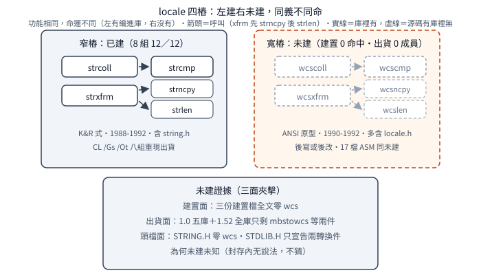

# `locale` 樁与未建的寬字串

一句話：Visual C++ 1.0 的 `strcoll／strxfrm` 是 C locale
恆等樁（樁＝已出貨但只轉發別人的殼；
前者直調 `strcmp`，後者 `strncpy` 加回 `strlen`），
建置檔記 `CL=-Oart -Gs`，
`CL /Gs /Ot` 八組（兩函式×四模型）12 項語意檢查全同重現；
寬版雙生（寬版操作 `wchar_t`，檔名 `WCS*` 即 wide-char string；
`wcscoll／wcsxfrm`）与 17 檔 `WCS*.ASM`
全未建（未建＝源碼存在但沒編進任何 `.LIB`：
建置檔零命中、出貨零成員），
三處世代差指向寬版後寫，
完成度低吻合未建。
延伸閱讀：被轉發的實作見
[`strcpy` 家族](strcpy-family.md)（`strncpy`）与
[`strcmp` 家族](strcmp-family.md)（`strcmp`）。

## 結論

分級先行：樁行為（已證實）、建置旗（已證實：
建置檔記載加位元組重現一致）、
寬版後寫（強推論）、未建（已證實）、
為何未建（未知）。

C locale（預設不分國家、
直接比 byte 值的排序規則）下排序等同位元組序，
故 `strcoll` 全函只需一句轉發；
`strxfrm` 恆等轉換：搬 `strncpy(d,s,n)`、
回 `strlen(s)`——
回傳值是來源長度，与 `n` 無關；
`retval>=count` 時目的无結束符
（`NUL`，字串結尾 `'\0'`，不是空指標 `NULL`；
`strncpy` 語意直承；
`count>0` 截斷案——`count=0` 目的原樣不動）。
檔頭允許 `strxfrm(NULL,s,0)` 量長而不搬：
碼面无 `NULL` 保護，直打 `strncpy(NULL,s,0)`——
依賴 `strncpy` 零步不碰目的：
探針 `strxfrm(NULL,"abc",0)` 回 3 且程式沒死，
A（1.0 重建）B（1.52 出貨）兩側皆如此。
兩樁出貨碼是典型編譯器產物：
`coll` 16 位元組（取參、調 `strcmp`、
`mov sp,bp` 清參數——
C calling convention 由呼叫端清堆疊，
`mov sp,bp` 是整批丟），
`xfrm` `_TEXT` 28 位元組（含尾端 `90 NOP` 墊，
對齊填充，不影響語意；
兩次取參調用）。

建置旗有記載、重現又吻合：
`BUILD.BAT` 記 `CL=-Zl -nologo -Oart -Gs -c -W3`
（M／L 另加 `-NT _TEXT`；
`-Oart`＝`/Oa` 不假設別名加
`/Or` 通用出口加 `/Ot` 速度優先），
`CL /Gs /Ot`（M／L 另加 `/NT_TEXT`）
八組 12／12 重現出貨——
僅「`/Oa／/Or` 對此二函數无影響」是推論
（重現旗是記載的子集仍全同）。
排除史佐證配方唯一：
1.52 `CL` 預設編出 32 位元組
（堆疊探針——函式開頭檢查堆疊夠不夠的 helper、
`SI／DI` 存檔——callee-saved 暫存器保守先存、
`add sp` 清參——把堆疊指標加回去），
`/Gs`（關堆疊探針）去探針但 `SI／DI` 殘留；
`/Gs /Ot`（`/Ot` 速度優先）全中；
`/Gs /Os`（`/Os` 大小優先）在 small-`xfrm` 差一字节
（1.52 用 `pop bx` 清最後一參——
1 位元組但順便污染 `BX`，
出貨用 `mov sp,bp` 加 `NOP`——
1.52 的 size-peephole（編譯器最後一遍掃相鄰指令
做局部替換，此處把 `mov sp,bp` 加墊換成 `pop bx`）
在 1.0 不存在或未啟用），
故 `/Os` 一票否决（旗標是全域配方，
一個反例就夠）；
`/Ox`（最大優化，含函式內聯）
把 `strcmp` 內聯進 `strcoll`，更不對。
（`strcoll` 在 `/Os` 下同形是巧合：
本函太短、沒有可替換的相鄰 pattern，
叫无 peephole 窗口。）
殘差只有 `COMENT` 前言
（`.OBJ` 裡編譯器自注身分的記錄，不是機器碼：
`9F defaultlib` 差異是建置檔 `-Zl`
（不寫預設庫名）所致，非版本差；
僅 `00"MS C"` 編譯器名自注保留為版本差）；
版本戳（目的檔註記裡的編譯器版本戳記，
`9D 30 73 4F`）兩邊一致
（同 8.0 世代工具鏈產物旁證）。

寬版四樁之二是未建品：
`wcscoll／wcsxfrm` 与窄版同義
（`wcscmp` 轉發／`wcsncpy` 加 `wcslen`），
但建置檔三份零 `wcs`、
出貨五庫零成員
（`wcs` 字樣只剩 `mbstowcs／wcstombs` 轉換件）。
三處世代差：ANSI 原型（參數括自成行、逐參一行）
對窄版 K&R 式（同行參數加分離宣告）、
版權 1990-1992（窄版 1988-1992）、
多 `#include <locale.h>`——
寬版後寫或後改，非同期鏡像（強推論）。
17 檔 `WCS*.ASM` 同未建：
全數通過 `ML 6.11` 組譯（无語法腐爛），
骨架与窄版同（`w` 化指令），
但 far 守衛系統性缺席、零 `AHINCR`、
註解懸空、慣用法相異、`WCSREV` 非鏡像重構——
完成度低吻合未建。
為何未建（時程砍還是本來就沒要）未知，
封存內无說法，不猜。

## 根本問題

ANSI C 要求 `strcoll／strxfrm` 按當前 locale 排序；
但 1.0 只實作 C locale，
而 C locale 的排序序就是位元組序——
樁是誠實的完備實作，不是偷懶：
需求退化成恆等轉換，碼就該是一句轉發。
寬字串側是反面：`wchar_t` 介面寫了一半
（17 檔組譯加兩樁，
但 `STRING.H` 零 `wcs` 宣告——頭檔沒跟上），
卻沒人把它編進任何一庫——
問題從「怎麼實作」變成「為何缺席」，
證據只夠說到「未建」，不夠說「為何」。

## 推導

### 樁轉發：兩句的完備實作

`strcoll` 全函一句：回 `strcmp` 結果。
`strxfrm` 兩步：`strncpy(d,s,n)` 搬運、
回 `strlen(s)` 長度。
注意回傳值語意：恆等轉換下轉換後長度恆等於來源長度，
故与 `n` 無關——
截斷案（`n=3`）回 5（來源 `hello` 長），
目的只取前三字；
零案（`n=0`）回 5，目的原樣不動；
空串回 0。
`retval>=count` 时目的无結束符
（`count>0` 截斷案）：
`strncpy` 不補 `NUL`，樁原樣繼承，不加料。

### NULL 鏈：祝福、依賴、存活

檔頭允許 `strxfrm(NULL,s,0)`：
傳 `NULL` 目的加零計數，只問長度不搬運。
碼面沒有 `if (d)` 保護——
直打 `strncpy(NULL,s,0)`，
賭 `strncpy` 零步連讀都不讀目的。
探針證兩邊皆成立：
`strxfrm(NULL,"abc",0)=3` 且程式存活
（`alive=1`），A（重建）B（1.52）同。
依賴鏈：樁的契約由被調函式的邊界行為背書，
不是由自己的檢查背書——
讀樁必須連被調一起讀。
標準不保證 `NULL` 目的（實作行為），
故本輪以 A／B 探針實證兩邊皆存活，
不是拿規格當證據。

### 旗標：記載加排除表

`.C` 配方建置檔有留字：
`BUILD.BAT` 以 `CL` 環境變數記
`CL=-Zl -nologo -Oart -Gs -c -W3`
（M／L 另加 `-NT _TEXT`），
`MEM` 逐模型展開（S／M／C／L 各一）——
`README` 明說重建要看 `BUILD.BAT` 取環境設定。
`CL /Gs /Ot`（M／L 另加 `/NT_TEXT`）
八組 12／12 重現出貨，
与記載相容（重現旗是記載的子集）；
僅「`/Oa／/Or` 對此二函數无影響」是推論。
排除表（佐證配方唯一）：

| 旗標 | 預測形狀 | 實際看到 | 結論 |
|---|---|---|---|
| 預設 | 32 位元組 | 探針、`SI／DI`、`add sp` 全在 | 淘汰：出貨 16，無探針 |
| `/Gs` | 去探針 | 探針去、`SI／DI` 殘留 | 淘汰：出貨无 `SI／DI` 存檔 |
| `/Gs /Ot` | 出貨形 | 八組 12／12 全同 | 保留：与記載相容 |
| `/Gs /Os` | 出貨形 | `strcoll` 同形、`strxfrm` small 差一字节 | 一票否决：small-`xfrm` 用 `pop bx`，出貨用 `mov sp,bp` 加墊 |
| `/Ox` | 出貨形 | `strcmp` 被內聯進 `strcoll` | 淘汰：形狀全非 |

（`strcoll` 在 `/Os` 下同形是巧合：
本函太短、无 peephole 窗口，兩旗收斂；
一個反例就夠，因為旗標是全域配方，
不能一個函式一個旗。）
附帶：large 在 `/Gs /Os` 下反而全同——
large 是 far call，收尾指令序列不同，
peephole 的 pattern 對不上所以沒觸發；
但配方若是 `/Os`，small 就該長 `/Os` 樣——
small 的反例仍有效。

### 世代差：三源一致的後寫證據

窄寬四樁並排，三處差全指向同一年表：
函式定義窄版 K&R 式、寬版 ANSI 原型
（參數括自成行、逐參一行——
不是同一隻手同期寫的排版）；
版權窄版 1988-1992、寬版 1990-1992；
寬版多 `#include <locale.h>`。
兩式長這樣（示意，非原文）：

```text
K&R 式：  int f(a, b) int a; char *b; { ... }
ANSI 式： int f(int a, char *b) { ... }
```

封存內兩式並存（正處過渡的年頭）。
任一處都可單獨解釋（改排版、改年份、加頭檔），
但三個獨立面向同時偏同一方向，
巧合機率低：寬版後寫或後改（強推論）。
「後寫或後改」含兩種可能——
整檔晚寫，或舊檔後來改過——
證據分不開。
注意推論邊界：只能說源碼的相對新舊，
不能說寬版為哪一版準備、也不能說何時寫的——
封存內无日期證據。

### 未建調查：三面夾擊与完成度

背景一句：16 位元 far 指標跨段要手動調段暫存器
（huge 模型另有 `AHINCR` 步進幫手），
守衛即處理跨段邊界的保護碼；
`ML` 是 Microsoft Macro Assembler，
腐爛指源碼壞到連組譯都過不了。
未建是三面夾擊的結論：
建置面三份建置檔
（`MAKEFILE／MAKEFILE.N／MAKEFILE.H`）
全文零 `wcs`（大小寫不敏感）、
出貨面五庫
（`SLIBCR／MLIBCR／CLIBCR／LLIBCR／LIBH`）
含 `wcs` 符號只剩兩轉換件
（轉換件指 `.LIB` 裡負責多 byte 與寬字元互轉的
`mbstowcs／wcstombs` 兩 `.OBJ` 成員）、
1.52 全庫掃同（各 CRT 庫同兩件，
他庫无 `wcs` 函式——
`GRAPHICS.LIB` 有一 `B$OVWCSR` 字樣巧合，
非 `wcs*` 函式）、
頭檔面 `STRING.H` 零 `wcs`、
只有 `STDLIB.H` 宣告兩轉換件——
宣告集合恰等於出貨成員集合。
源碼側吻合：17 檔全過 `ML 6.11` 組譯，
但 far 守衛系統性缺席
（`WCSLEN` 无條件、`WCSCPY` 无飽和頭、
`WCSSTR` 缺兩處長度守衛——
窄版同位全有）、
全目錄零 `AHINCR`（寬版沒寫 huge 路徑，
`MODELINDEP` 分支只是 far 版）；
`WCSCPY` 註解懸空
（註解寫的是窄版 `shr` 移位算長度的進位說明，
留在寬版 `rep movsw` 搬字串底下，
文不對題，疑複製貼上忘改）；
`WCSSET` 取長用 `inc／inc／neg`
（窄版 `not／dec` 少一指令——異手筆旁證）；
`WCSREV` 非鏡像重構
（`sub di,4` 對調指針角色、
`xchg／stosw` 三指令交換——
動機可解：`stosw` 綁死 `DI`，
故前端指針必須是 `DI`）。
單一異手筆可解釋，
但「系統性缺 far 守衛加全目錄零 `AHINCR`
加註解文不對題」三類同時出現、
且窄版同位全有，
最省的解釋是寬版沒走完跟窄版同等的除錯流程；
承認這是吻合旁證，不是未建的證明——
證明是建置加出貨加頭檔三面零命中。

## 在執行檔裡怎麼認

本批无簽章檔，理由兩條。
第一，寬版 17 檔加兩樁全未建：
出貨庫裡沒有這些位元組，
簽章无處取樣，也无處命中。
第二，兩窄樁是編譯器產物且太短：
`coll` 全函 16 位元組、`xfrm` 28 位元組（含墊），
形狀是通用呼叫包裝
（取參、調 `strcmp／strncpy／strlen`、
`mov sp,bp` 清參數）——
短到任何同旗編出的轉發函式都長這樣，
固定位元組誤報太高，撑不起可用的簽章。
簽章指能在未知執行檔裡指認函式的位元組樣式。
手認只認形狀：找 `call` 到
`_strcmp／_strncpy／_strlen` 的小包裝
（C 符號在目的檔層加底線）；
前後是 `push bp／mov bp,sp` 開場建框
与 `mov sp,bp／pop bp／ret` 拆框收尾——
認這對括號；
`xfrm` 有兩次呼叫，尾巴多一顆 `NOP`。
`wcscoll／wcsxfrm` 与 `WCS*` 在以出貨 CRT
連結的 1.0／1.52 執行檔裡不該出現——
出現了就是別家（或自寫）的寬字串。

四樁對照見下圖（旗標与行為細節見正文）：

<p align="center"></p>

## 行為規格（已證實）

測試矩陣：A（1.0 源碼重建的待測碼）对
B（1.52 出貨庫對照組），乘兩種模擬器
（DOSBox、dosgolem）得四格，
每格輸出全同才算過。
`sign` 是測試 helper：
C 只保證比較結果的正負零、不保證是正負 1，
故先取符號再比。
測試 setup：`d` 是 64 位元組緩衝，
每案先填哨兵（`ZZZZZZ` 或空串），
驗搬後內容、有無結束符、未碰位元組是否原樣。

| 呼叫 | 結果 | 測過的記憶體模型 |
|---|---|---|
| `strcoll("a","b")` | `−1` | small＋large |
| `strcoll("b","a")` | `＋1` | small＋large |
| `strcoll("a","a")` | `0` | small＋large |
| `strcoll("ab","abc")`（前綴） | `−1` | small 实測 |
| `strxfrm(d,"hello",64)` | `d=hello`、回 5 | small＋large |
| `strxfrm(d,"hello",3)`（截斷） | 回 5、`d` 前三字 `hel` | small＋large（large 探針只印回傳值，无緩衝比對） |
| `strxfrm(d,"hello",0)`（零） | 回 5、`d` 不動 | small 实測 |
| `strxfrm(d,"",64)`（空） | 回 0 | small 实測 |
| `strxfrm(NULL,"abc",0)`（獨立探針） | 回 3、程式存活 | small 实測 |

small 八案（10491 步）与 large 五案（7122 步，
步＝模擬器指令計數，證真的跑完非早退）、
獨立探針（3316 步），四格輸出全一致。
（上表三案拆三行故九行；
案數以測試印出行為準：small 八行、large 五行。）

## 證據、方法與未知

靜態八組（兩樁 × S／M／C／L，
1.52 `CL /Gs /Ot` 重編，
M／L 另加 `/NT_TEXT`）：12／12 全同，
与 `BUILD.BAT` 記載（`-Oart -Gs`，
M／L `-NT _TEXT`）相容——
旗標結論已證實，
僅 `/Oa／/Or` 无影響留為推論。
`strcoll` 在 `/Os` 下同形是巧合
（无 peephole 窗口），
`strxfrm` 在 `/Gs /Os` 下 small 差一字节、
large 全同。
殘差：`9F defaultlib` 是建置檔 `-Zl` 所致、
僅 `00"MS C"` 為版本差；
版本戳 `9D 30 73 4F` 兩邊一致。
行為見上表；A 側連結乾淨。
宽版无靜態无行為（未建品），
結論全為源碼層（`reviewed`）。

未知：寬版為何未建（時程砍還是本來就沒要）；
寬版源碼的絕對寫作時間
（只有与窄版的相對新舊）；
`mbstowcs／wcstombs` 兩轉換件的實作
（出貨有成員，源碼在 `VCCRT1/CONVERT` 目錄，
本輪未讀）。
