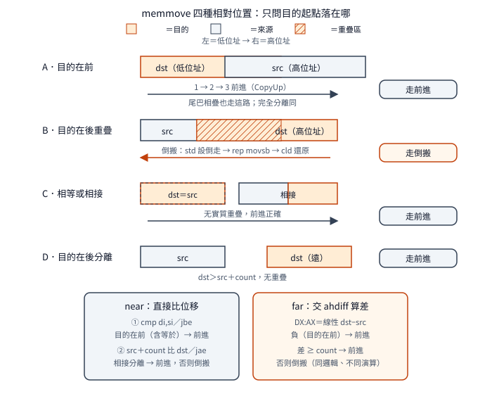

# `mem` 家族：記憶體塊的複製、比較、搜尋与填寫

一句話：Visual C++ 1.0 的七個記憶體塊函式裡，
複製／填寫兩系（`memcpy／memmove／memset`，near＋far）
共用一套字組搬運骨架
（`shr` 取字組數、`rep movsw` 整批搬、`adc` 收尾，
near 另有奇位址先搬一 byte），
`memmove` 用重疊判斷分前進倒搬兩路徑，
far 版用無分支 `MIN` 分塊加段步進跨段，
比較函式用 `sbb` 對子无分支取正負，
搜尋／比對另用串掃描指令与逐 byte 迴圈。
延伸閱讀：字串複製見
[`strcpy` 家族](strcpy-family.md)，
字串比較見
[`strcmp` 家族](strcmp-family.md)。

## 結論

七個函式全是「給起點加長度」：沒有結束符，
`count` 就是唯一的邊界。
`memcpy／memmove` 同一份源碼，
靠 `MEM_MOVE` 開關編出兩件庫成員；
far-data 模型（compact／large／huge——
near＝同段內指標只有位移，
far＝跨段指標段加位移，後文同）
另有 `hmemcpy` 源，靠 `MEM_MOVE／MEM_CCPY`
一源三件；大小寫不敏感比較另有
`CASE_INSENSITIVE` 開關。
同源多件在庫裡靠檔名後綴拆件
（`MEMCPY` 与 `MEMCPY~2` 是不同函式——
名為 `MEMCPY` 的成員裝的是 `memmove`）。

搬運骨架是複製／填寫兩系
（`memcpy／memmove／memset`，near＋far）共用：
`shr` 取字組數（餘數進 `CF` 旗標）、
`rep movsw` 整批搬字組、
`adc cx,cx` 把 `CF` 變回 0 或 1、
`rep movsb` 收尾；
near 另有奇位址試探
（`test` 目的奇位址先 `movsb` 一 byte、`dec` 計數），
far 直入 `shr`。
只查目的對齊、不查來源——
下表四種組合只加速「雙奇」一種，
是刻意取捨（註解自述），不是疏漏。
`memcmp／memchr` 系用串掃描指令
（`repe cmpsb／repne scasb`），
`memccpy／memicmp` 系逐 byte 迴圈，
不走此骨架。

| 來源＼目的 | 偶 | 奇 |
|---|---|---|
| 偶 | 快（雙偶直入，不試探） | 慢（試探搬一 byte 後來源反錯位） |
| 奇 | 慢（目的偶不試探，來源奇） | 快（試探後雙偶——試探唯一立功格） |

`memmove` 的重疊判斷只問一件事：
目的起點有沒有落在「來源區間內且在來源起點之後」。
near 版：`cmp di,si／jbe` 先擋掉目的在前，
再比 `dst>=src+count` 擋掉首尾相接；
兩關都過才倒搬。
far 版：把差值交給外部 helper
（`ahdiff`，回傳 `DX:AX` 有號差）
再做同式判斷。
`dst==src` 与首尾相接都走前進——
无實質重疊，前進正確。
倒搬是 `SI／DI+=count-1` 指到尾、
`std` 借方向旗標、`rep movsb`、`cld` 必還、
跳過前進段直出。

far 版前進是分塊迴圈：
每輪 `Num=MIN(Count,65536-SI,65536-DI)`，
搬完 `SI／DI==0` 才把 `DS／ES` 加一段
（`__AHINCR`＝4096 個段落單位）；
倒搬是 `Num=MIN(Count,SI+1,DI+1)`，
`SI／DI==FFFFh` 就減一段。
`MIN` 用 `sub／sbb／and／add` 無分支惯用法，
`memcmp` 系的 −1／＋1 用 `sbb ax,ax／sbb ax,-1`
（`1B C0 83 D8 FF`，`CY=1→−1`），far `memicmp` 的大小寫映射
用 `sub／cmp／sbb／and／add／add` 無分支轉小寫——
near `memicmp` 卻是 `cmp／jb／cmp／ja` 跳轉式，
与 `cProc` 保存风格等三處差異指向不同作者。

零計數多半 `jcxz` 直出；
far `memmove` 卻用七位元組二跳
（`or／jnz／jmp`，語意等價，動機不明）。
回傳值多半從堆疊重讀目的起點
（經 `SS` 取址，`DS／ES／SI／DI` 已髒無妨）；
`memccpy` 命中回字元之後、走完回 `NULL`，
`memchr` 命中回命中位址（near 版 `AX=DI-1`、
far 版 `ES:DI-1`）、否則 `NULL`。
near 源裡的 `MODELINDEP`（`_f*` 名）分支
六檔全死（出貨 89 庫零命中）——
出貨的 far 名全來自 `hmem*` 源；
与 `str*` 系同結構卻活著（例 `strlen`）正好對讀。

## 根本問題

記憶體塊操作有四個現實約束。
第一，没有結束符：字串函式量長靠掃 `NUL`，
`mem` 系只能信 `count`——
零計數、奇計數、奇位址全是呼叫端传進來的形狀，
碼裡一個都不能假設。
第二，重疊：`memcpy` 契約不管重疊，
`memmove` 必須處理——
目的在來源之後且重疊時前進會先蓋掉還沒搬的來源，
只能倒搬；判斷本身必須廉價（兩次比較）。
第三，對齊：8086 字組搬運在偶位址最快，
但來源与目的各奇各偶有四種組合——
全查要四路分派，只查目的只要一次 `test`。
第四，分段：far 指標 16 位元位移隨時到段尾，
一段 64K 的塊可能橫跨兩段——
near 版假裝段夠大，far 版必須分塊加步進，
而 `count` 16 位元本身把跨段上限釘死在一段。

## 推導

### 一源多件：開關与拆件

`memcpy` 源无開關編出 `memcpy`，
加 `-DMEM_MOVE` 編出 `memmove`：
兩件 `THEADR`（目的檔內記源檔名的欄位）同為
`memcpy.asm`，建庫時同名拆成
`MEMCPY.OBJ`（裝 `memmove`）与
`MEMCPY~2.OBJ`（裝 `memcpy`）。
far-data 源同理一源三件：
無開關、`MEM_MOVE`、`MEM_CCPY` 各一件，
庫內是 `HMEMCPY／~2／~3`
（C／L 兩庫是 `memccpy／memmove／memcpy` 順序；
`LIBH` 的 `_f` 版是 `fmemccpy／fmemcpy／fmemmove`——
`fmemcpy` 在 `fmemmove` 之前，順序不同）。
比較源另有 `CASE_INSENSITIVE`：
`hmemcmp` 无開關是 `memcmp`、
有開關是 `_memicmp`，
庫內是 `HMEMCMP`（裝 `memicmp`）与 `~2`（裝 `memcmp`，
`LIBH` 为 `_f` 版）。
認執行檔時記住：成員名是源檔名，
符號名才是函式——兩者不一定對得上：

```text
MEMCPY.OBJ   ->  _memmove     （成員名 memcpy，裝的是 memmove）
MEMCPY~2.OBJ ->  _memcpy
HMEMCMP.OBJ  ->  __memicmp    （成員名 memcmp，裝的是 memicmp）
```

庫名對記憶體模型（後文簡寫所指）：

| 庫檔 | 模型 | 碼／數 | 符號例 |
|---|---|---|---|
| `SLIBCR` | small | near／near | `_memcpy` |
| `MLIBCR` | medium | far／near | `_memcpy` |
| `CLIBCR` | compact | near／far | `_memcpy` |
| `LLIBCR` | large | far／far | `_memcpy` |
| `LIBH` | huge 輔助 | far／far | `__fmemcpy` |

### 字組骨架：四件套

暫存器角色先行：`SI`＝來源游標、`DI`＝目的游標、
`CX`＝計數器、`CF`＝進位旗標
（`shr` 把掉出去的位元放在這裡）；
`test al,1` 測最低位即判奇偶。
near `memcpy` 全函式 44 位元組，
骨架是：存 `SI／DI`（`mov dx,di／mov bx,si`）、
`ES=DS`、取三參、存回傳值（`mov ax,di`）、
`jcxz` 擋零、`test al,1` 奇位址先 `movsb`、
`dec`、`shr cx,1`（除以 2，餘數掉進 `CF`）、
`rep movsw`、`adc cx,cx`（此處 `CX` 已被 `rep` 耗成 0，
故得 `0＋0＋CF`＝`CF` 自身，即 0 或 1）、
`rep movsb`、還原、返回。
走兩遍：`count=7` 偶目的：
`shr` 得 3（`CF=1`），`movsw`×3，
`adc` 得 1，收尾 `movsb`×1；
`count=7` 奇目的：先 `movsb`×1 剩 6，
`shr` 得 3（`CF=0`），`movsw`×3，收尾 0。
`memset` 同骨架（`rep stosw／stosb`，
`AL→AH` 先擴字），不需 `push DS`
（无 `lds` 改寫段暫存器；
它讀 `DS` 取 `ES`，但不存不斷）。
far 版前進段內搬法与 near 同四件套
（无奇位址試探，直入 `shr`），
只把取參換成 `lds／les` 連段取。

### 重疊：前進或倒搬

near `memmove` 中段是重疊判斷：
`dst<src` 走前進（`jbe` 含等於），
否則算 `src+count` 再比 `dst`
（`mov ax,si／add ax,cx／cmp di,ax／jae`）：
`dst>=src+count`（首尾相接或分離）仍走前進，
真正重疊才倒搬
（效果等同 `dst−src` 与 `count` 比大小；
`src+count` 繞回 64K 的角落未探）。
倒搬四步（near）：指針加到尾、
`std` 把方向旗標設為倒走
（`rep movsb` 改為位址遞減）、
整段 `rep movsb`、
`cld` 搬完必須清回來
（否則呼叫端的字串指令全会倒走），
跳過前進段直出；
far 版初值另有進位段步進，且後接分塊迴圈。
`dst==src` 走前進：自己蓋自己，前進正確。

為什麼目的在前就一定安全？
看 8-byte 例子（`src=100h:[A B C D E F G H]`，
`dst=102h`，`count=6`，
即目的在後且重疊——必須倒搬的案）：
前進逐 byte 蓋，`102h` 先被寫成 `A`，
輪到搬第 3 個時來源已被汙染，
`dst` 區錯成 `A B A B A B`；
倒搬從尾開始，來源讀完才被蓋，
`dst` 區正確得 `A B C D E F`。
反過來 `dst=src−1` 時前進每步讀的都是還沒被蓋的來源，
故安全——這就是判斷式只問目的起點的理由。

far 版判斷交給 `ahdiff`：
先推 `src` 再推 `dst`（四字參數），
`a=dst` 故回線性 `dst−src`（`DX:AX`：
`DX` 高 16 位、`AX` 低 16 位拼成 32 位元——
跨段相減可能超過 16 位元）——
負值（目的在前，不論同段異段）走前進，
`差<count` 才倒搬。
呼叫是長度差主因（`E8` 3 位元組對 `9A` 5 位元組，
`LEDATA`（目的檔內記機器碼的欄位）200 對 202），
另有取參位移与 `C3／CB` 差。
行為證下搬重疊案輸出正確
（前進会蓋壞來源，見上例），
跨段正反向全過；
異段負值走前進由碼面 `or dx,dx／js` 靜讀得知
（无重疊時兩路徑輸出相同，行為分不出路徑），
行為僅證輸出正確（`mov-seg=49082`）。

下圖是四種相對位置的走法
（`CopyUp` 是 near 版前進段的標號名，
即低位址往高位址搬；far 版同段叫 `next`）：

<p align="center"></p>

### 無分支慣用法：MIN、sbb、映射

far 版 `MIN` 不用跳轉，但先有首尾舞步：
`count` 放不下 65536（16 位元上限 65535），
故先 `dec` 取 `Count−1`，
与 `not` 取 `~DI＝65535−DI` 做無分支 `MIN`
（`sub／sbb／and／add` 四件：
`sub` 試減立借位、`sbb bx,bx` 得 0 或 `FFFFh` 遮罩、
`and` 留小邊、`add` 補回），
`SI` 側再來一次，最後 `inc` 補回——
效果是 `MIN(Count,65536−SI,65536−DI)`。
走一遍（`Count=100`、`DI=FFEFh` 即段剩餘 17）：
`AX=99`，与 `~DI=16` 取小得 16，
`SI` 側不更小，最後 `inc` 得 17。
`memcmp` 系歧異出口：`sbb ax,ax` 得 0 或 −1，
`sbb ax,-1` 得 ＋1 或 −1——
`cmpsb` 的借位直接變符號：

| 進位 `CY` | `sbb ax,ax` 後 | `sbb ax,−1` 後 |
|---|---|---|
| 0（`buf1≥buf2`） | 0 | ＋1 |
| 1（`buf1<buf2`） | −1（`FFFFh`） | −1（`FFFFh−FFFFh−1` 借位繞回） |

far `memicmp` 的大小寫映射：
`sub 'A'／cmp 26／sbb bl,bl／and 20h／add／add 'A'`
兩邊各一遍，无分支轉小寫再比
（`20h`＝32 正是大小寫差值；
`and` 前 `bl` 是 `FFh` 或 0，
故只在大寫時加 32）。
走一遍：`'A'`→減後 0→`CY=1`→`bl=FFh`→
`and` 得 `20h`→加回得 `'a'`；
`'a'`→減後 32→`CY=0`→`bl=0`→不動；
`'1'`→減後 wraparound 成 240→`CY=0`→不動。
near `memicmp` 同功能卻是
`cmp 'A'／jb／cmp 'Z'／ja` 跳轉式——
加上 `cProc<si,di>` 巨集保存
（對 far 同功能版手寫 `push ds／si／di`，
`memcmp` 手寫 `dx／bx` 是第三種风格）
与全檔小寫參數巨集，
三處風格差指向不同作者
（`memccpy` near 版与 `memicmp`
共享三處指紋：小寫巨集、
`lupe` 標號、`push ds／pop es`——
強推論同一人；
`sorc` 拼字只在 `memccpy` 出現，
`memicmp` 用 `first／last`）。

### 零計數：jcxz 与七位元組怪寫

零計數七支全擋（六支 `jcxz`），
但回傳值就位時機各不同：
`memcpy／memchr／memcmp` 跳前已備好
（目的起點、`NULL`、0 各就其位）；
`memccpy` 跳後 `xor` 清出 `NULL` 再取；
`memset` 跳前只有 `BX` 就位，
跳後 `xchg ax,bx` 才交卷；
`memicmp` 跳後沿用 `CX＝0`（即 `count` 本身）。
far `memmove` 例外：`or cx,cx／jnz／jmp done`
七位元組二跳，語意与 `jcxz` 等價——
簽章裡看得到（`0B C9 75 03 E9` 對它支的 `E3`），
動機不明（已證實的怪寫法，不猜）。

### 跨段：AHINCR 步進与型別裡的上界

far 版段暫存器是手動維護的。
先算地址：段暫存器加 1＝線性位址加 16 bytes
（一 paragraph）；`DS=1000h:SI=FFF0h`＝線性 `1FFF0h`，
搬 16 bytes 後 `SI` 歸零——
歸零即到段尾（位移繞回 0），
`DS+=__AHINCR`（4096 paragraphs＝64KB，
`1<<__AHSHIFT`，絕對符號由外部提供）
進下一段：`2000h:0`＝線性 `20000h`，剛好接上。
前進每輪搬 `MIN` 量：
位移是 16 位元（`0～FFFFh`），
從 `SI` 出發到段尾還剩 `65536−SI` bytes，
取 `MIN(Count,65536−SI,65536−DI)` 保證本輪兩端
都不踩過段界（例 `SI=FFF0h、Count=48` 首輪 16）；倒搬從尾往頭，
限制是到段首的距離 `SI+1`（含自己指的那 byte），
故 `Num=MIN(Count,SI+1,DI+1)`，
`SI／DI==FFFFh` 就減一段。
一次兩輪追蹤（首段尾 16＋次段 32）：
輪 1（`SI=FFF0h,Num=16`，搬完 `SI=0,DS+4096`）
→輪 2（`SI=0,Num=32`，搬完收工）。
`memcpy／memmove／memccpy／memcmp／memicmp`
要迴圈（兩端各跨，塊數由對齊決定——
每端至多跨一次，故至多三塊），
`memset／memchr` 卻无迴圈：
只有目的（或掃描）一端，
`DI` 最大 `FFFFh`＋`count` 最大 `FFFFh`＝`1FFFEh`，
只超過段界一次——
上界寫在型別裡，不在碼裡。
分塊用同式無分支 `MIN`
（`DX=min(65536−DI,CX)`，
`CX` 取本段量、`DX` 留下段量）；
`DI=0` 時 `neg` 得 0，
`jz` 跳過 `MIN`（整段搬，`CX` 不動）。

### 回傳与紀律：重讀、ES、不變量

回傳目的起點有三式：
near `memcpy` 入門 `mov ax,di` 存好；
`memset` 用 `xchg ax,bx` 交卷
（`BX` 存的目的）；
far 版從堆疊重讀（經 `SS` 取址：
搬運過程会改掉 `DS／ES／SI／DI`（叫弄髒），
但堆疊上的參數還在，
用 `SS`（堆疊段）去讀就拿得到乾淨的目的位址——
行為 `cpy／mov` 七案 `ret=1` 全證）。
`memccpy` 命中回字元之後（`DI`，far 另帶 `ES`）、
走完回 `NULL`（`xor` 清後取）。
`memchr` near 版入門只 `xor ax,ax`
（`cwd` 与命中路的 `dx=es` 都包在
`sizeD` 條件裡，本源只編 near-data 故从未組出——
near 回傳只用 `AX`，`DX` 不動）；
`DI` 存 `BX`，`repne scasb`，
掃完 `mov ax,0`（`B8 00 00`）先備 `NULL`、
`jne` 走完即回，
命中 `lea ax,[di-1]`（`8D 45 FF`）。
far 版分塊掃：`found` 取 `dx=es、ax=di-1`，
`notfound` 重設 `xor／cwd`——
不依賴入門值，結構更乾淨。
`movsw` 硬性規定從 `DS:SI` 搬到 `ES:DI`；
near 版來源目的同段，故先把 `ES` 設成跟 `DS` 一樣。
`ES=DS` 有兩式：`mov ax,ds／mov es,ax`
（`memcpy／memcmp／memset／memchr` 系）与
`push ds／pop es` 二位元組（`memicmp／memccpy` 系——
又是筆跡線索）。
收尾分三式（`cEnd` 是 MASM 函式尾巨集，
依種類決定發哪些收尾指令；
`mov sp,bp` 本來用來還原被 `push` 弄亂的堆疊）。
`nogen`（`memcpy／memset／memchr／memcmp` near
加 `hmemset／hmemchr`）：巨集只發 `ret`，
`pop` 與 `pop bp` 全手寫——
有 `push` 的（`hmemset／hmemchr` 的 `push di`）
靠手動配平，不靠巨集。
`nolocals`（`hmemcpy／hmemcmp`）：
手寫 `pop si／di／ds` 在前，
巨集發 `pop bp／ret`，**不發 `mov sp,bp`**
（巨集源明寫 `nolocals` 跳過此條，
出貨尾端確无此指令）。
full（`memicmp` 自動存檔、`memccpy`）：
巨集發 `mov sp,bp／pop bp／ret`
（出貨 `memccpy` 尾端看得到 `8B E5`）。
medium 對 small 只差四處
（取參位移各加 2、`C3→CB` far 返回；
四參數的 `memccpy` 是五處）。

### 死分支：mem 全死、str 全活

`MODELINDEP`＝model-independent：
讓 near 版源碼也能編出 far 函式
（`_f` 前綴版）的條件編譯分支。
六個 near 源的此分支
（`_fmemcpy／_fmemset／_fmemchr／_fmemcmp／
_fmemicmp／_fmemccpy`）建置出貨兩面皆死：
用 `.n` 的規則不帶此開關，
帶此開關的 `libh` 建置被 `.h` 覆寫源為 `hmem*`；
89 個出貨庫零命中。
出貨的 `_f` 名全來自 `hmem*` 源
（`MODELINDEP` 只換名不改碼：
large 与 `LIBH` 的 `LEDATA` 長度各對相等）。
對读 `str*` 系：同樣的
`ifdef MODELINDEP／cProc _fX` 結構，
`str*` 系是活的（例 `strlen`→`LIBH fstrlen`）——
結構對稱，命運不對稱。

### 註解三錯与未解

碼對、註解錯三類四處（行為側證碼是對的）：
`memset` 的 `jz` 註解 yes／no 寫反
（跳轉條件是「非奇」）；
`hmemcpy` 倒搬 `MIN` 註解寫 `65535-DI`，
實為 `DI`（倒搬以距段首距離為限）；
同檔 `DX=-SI` 實為 `~SI`（差一），
`hmemcmp` 有同款 `DX=-SI` 不精確。
未解：`ahdiff` 本體未深讀
（呼叫點靜讀推序加 `DX:AX` 用法，行為再證）；
far `memmove` 七位元組零數檢查動機不明；
huge 模型（`-AH`）行為未驗
（large 已覆 far-data 碼路；
源內无 huge 分支已確認，
huge 差在呼叫端處理，機制待查編譯器文件）。

## 在執行檔裡怎麼認

開場分兩大派。near 版（`SLIBCR／MLIBCR`）
`ES=DS` 先行：

```text
55 8B EC 8B D7 8B DE 8C D8 8E C0  ; memcpy／memmove／memcmp：push bp/mov bp,sp/存di,si/ES=DS
55 8B EC 8B D7 8C D8 8E C0        ; memset：省 SI（无來源，BX 存目的足矣）
55 8B EC 33 C0 ...                ; memchr：先清 AX（NULL 備位）
55 8B EC 56 57 ...                ; memicmp：cProc<si,di> 存檔在前
55 8B EC 57 56 1E 07              ; memccpy：push di/si + push ds/pop es
```

`memcpy` 与 `memmove` near 版開頭 23 位元組全同，
第 24 個分家：`jcxz` 位移 `0E`（跳到 44B 函式尾）
對 `2A`（跳到 72B 函式尾）——
`jcxz` 只在零計數跳出，非零直落：
前者落入奇位址試探（`A8 01`），
後者落入重疊判斷（`3B FE 76`＝`cmp di,si／jbe`）。

```text
memcpy : 55 8B EC 8B D7 8B DE 8C D8 8E C0 8B 76 06 8B 7E 04 8B C7 8B 4E 08 E3 0E ...
memmove: 55 8B EC 8B D7 8B DE 8C D8 8E C0 8B 76 06 8B 7E 04 8B C7 8B 4E 08 E3 2A ...
                                                                                 ^^
```
（`^^` 處即第 24 位元組：`0E` 往近處跳、`2A` 往遠處跳，
差的是到函式尾的距離。）
`memcmp` near 接 `repe cmpsb`（`F3 A6`，窗內）与
`sbb` 對子（`1B C0 83 D8 FF`——
對子橫跨窗界：窗內僅 `1B C0`，
`83 D8 FF` 在窗外；
far 版整對在窗外，0-based 第 81 位元組起）；
`memchr` 接 `repne scasb`（`F2 AE`，
near 後跟 `B8 00 00 75` 先備 `NULL`、
far 版 `F2 AE` 在窗外第 33 位元組起、
後跟 `74 15` 直跳命中——
窗內另有 `74 0C` 是分段跳轉，不要對錯）；
`memccpy` near 接 `lodsb／stosb／cmp／je／loop`
（`AC AA 3A C4 74 04 E2 F8`；
重建品此處是 `38 E0`——組譯器版本差，
簽章保留出貨編碼）。

far 版（`CLIBCR／LLIBCR／LIBH`）先取 `count`：

```text
55 8B EC 8B 4E 0C 1E 57 56        ; hmemcpy：取count/push ds,si,di（C 版位移 0C，L 版 0E）
55 8B EC 33 C0 8B 4E 0C E3 ...    ; hmemcmp：先清 AX，jcxz 擋零
55 8B EC 8B 4E 0A E3 ... 57       ; hmemset：取count/jcxz/push di
55 8B EC 57 8B 4E 0A E3 ...       ; hmemchr：push di 在先（与上支不同）
```

`hmemcpy` 接 `lds／les` 連段取
（`C5 76／C4 7E`）与 `MIN` 分塊；
`hmemmove` 獨門是七位元組零數檢查
（`0B C9 75 03 E9`，它支皆 `E3`）
与 `ahdiff` 呼叫（C 版 `E8` 後兩位元組、
L 版 `9A` 後三位元組連結時填，
簽章遮罩，`fixed` 28／27）；`hmemset／hmemchr` 接
`8B D7 F7 DA`（`mov dx,di／neg dx` 取段內剩餘）。
取參位移：遠碼參數位移各加 2（M 對 S、L 對 C），
遠資料指針佔 4 位元組（故 `count` 位移 near 8、far 12，
差 4 非 2；`memccpy` 多 `chr` 參數再加 2：
C `0E`／L `10`），`C3／CB` 分 near／far 返回。

完整樣式（七函式 28 筆：`LLIBCR` 与 `LIBH`
合併、每筆開頭連續 30 bytes、出貨 `.LIB`
取出；`hmemmove` 兩筆各含 `ahdiff` 呼叫遮罩，
`fixed` 28／27）在
[`mem-family.json`](../../signatures/msvc-1.0-crt/mem-family.json)，
用法与各筆差異見同目錄的
[簽章說明](../../signatures/msvc-1.0-crt/mem-family.md)，
取樣前先核對該檔列出的五個函式庫 SHA-256。

## 行為規格（已證實）

測試環境：自寫測試程式，測試矩陣是
2 種庫（A 連 1.0 源碼重建的目的檔、
其餘庫函式与 B 同連 1.52 出貨庫、
B 全連 1.52 出貨庫）× 2 種模擬器
（DOSBox、dosgolem）＝四格，
輸出逐位元組一致才算過；
small／medium／large 是記憶體模型各跑一遍。
`ret=1` 表示回傳指標与傳入目的頭相同。
表內數字均為輸出緩衝區加權 checksum
（`Σ p[i]×(i+1)`，同輸入同算法），
只用來比對四格一致与路徑分岔；
步＝dosgolem 執行的指令數，
同批四格步數一致佐證跑的是同一條碼路。

| 呼叫 | 結果 | 範圍／方法 |
|---|---|---|
| `memcpy` 偶／奇目的、計數 7 | 校驗 `10200／10000／1960`、回目的 | small＋medium |
| `memcpy(dst,src,0)` | 目的不動（緩衝預填 `Z` 驗仍全 `Z`）、回目的 | small＋medium 实測 |
| `memmove` 無重疊 | 同 `memcpy`（`10200`） | small＋medium |
| `memmove` 上搬（`dst<src`） | `mov-up=15638` | small＋medium |
| `memmove` 下搬（`dst>src` 重疊） | `mov-down=27664`（輸出正確，前進会蓋壞來源） | small＋medium |
| `memmove(dst,src,0)` | 目的不動（另案緩衝預填 `Q`）、回目的 | small＋medium 实測 |
| far `memcpy` 基本／跨段（`src=seg:FFF0` 長 48） | `28282／26302`、回目的 | large 实測 |
| far `memmove` 上搬／下搬／跨段下搬 | `62020／61364／41446` | large 实測 |
| far `memmove` 異段 `dst<src` | 輸出正確（`mov-seg=49082`；走前進由靜讀得知） | large 实測 |
| far `_memccpy` 命中／未中／零計數 | `670` 回字元之後／`NULL`／`NULL` | large 实測 |
| near `_memccpy` 命中／未中／首／尾／超界／零 | `670`／`NULL`／`65`／`5642`／`NULL`／`NULL` | small 六案 |
| `memset` 基本／奇位址（`set-basic=51968／odd=46903`） | 全填正確、回目的 | small 兩案＋large 基本案 |
| `memset` 跨段（`seg:FFF0` 長 48，`25016`）／零計數 | 全填正確／目的不動（`Z`） | large 跨段、small 零計數 |
| `memchr` 命中（small `found=2`、large `found=0`）／未中 | 命中回位址、否則 `NULL` | small＋large |
| `memchr` 零計數／目標在次段（`chr-cross=32`） | `NULL`／跨段命中 | small 零計數、large 跨段 |
| `memcmp` 小（`cmp-lt=−1`） | `−1` | small＋large |
| `memcmp` 等／大／零／中段歧異 | 等→0、大→＋1、零→0、中段 `'K'(0x4B)<'k'(0x6B)`→−1 | small 实測 |
| `memcmp` 歧異點在次段（`cmp-cross`） | 次段 `buf1<buf2`→−1、反向→＋1 | large 实測 |
| `_memicmp` 等／小／大 | `0／−1／＋1` | small＋large |
| `_memicmp` 非字母（`'1'` 對 `'A'`）／零 | `−1／0` | small 实測 |

small 十六案（24092 步）与 large 十案（23678 步）
是 `set／chr／cmp／icmp` 批；
`cpy／mov` 批 small 八案（17540 步）、
medium（17592 步，多 52 步，遠呼叫往返開銷，未細拆）；
far `cpy／mov／ccy` 十案（61054 步）；
near `ccy` 六案（14047 步）。
四格輸出全一致。

## 證據、方法與未知

兩種驗證各證明不同的事（靜態比重建与出貨的語意、
行為比兩種庫跑兩種模擬器的輸出）。
靜態 75 組（`ML 6.11` 依原廠旗標重編，
管線直跑）：R112 四組（S／M × `cpy／mov`）
7／7 全同（44／72 B）；
R113 九組（C／L／H × `cpy／mov／ccy`）
六組 9／9 全同、
三組 `memccpy` 各差一處等價編碼
（`cmp ah,al`：`38 C4` 對 `3A E0`）；
R115 廿組（near 四檔 × S／M 八組＋H 三檔十二組）
十五組全同、
五組 `memicmp` 純 `cmp` 編碼差
（near 各五處、far 各兩處）；
R116 六組（near `ccy`：S／M＋四個 Windows 庫）
各一處同式編碼差；
R114／R117 Windows 卅六組
（near 碼快照旗標即中、
far 碼去 `_WINDOWS` 即中，
出貨 `LEDATA` 与 DOS 版逐位元組一致）。
編碼差全是 `38` 系對 `3A` 系
（同語意不同編碼，組譯器版本差），
行為側全一致證等價；
其餘差異只有出貨端 `COMENT A3`
（`COMENT`＝目的檔內記註解的欄位，
`A3` 內容是 `-Fo` 目的檔名）。
A 側連結乾淨（重建目的檔与 1.52 出貨庫共存
无多重定義，MAP 對位：A 在 `_TEXT` 前段、
B 在庫區）。

未知：`ahdiff` 本体未深讀；
far `memmove` 七位元組零數檢查動機不明；
huge 模型行為未驗；
Windows 行為无環境不驗
（靜態 36 組全收，`STRDUP` 帶 `?IA` 首尾是 `STRING` 目錄例外
——全庫另有 84 件帶首尾在別目錄，成因待查證）。
