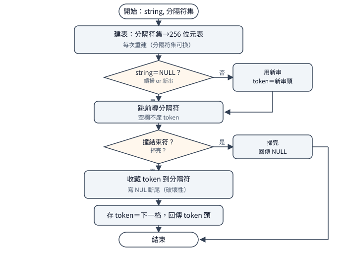

# `strchr` 家族：搜尋的三種算法与分詞狀態機

一句話：Visual C++ 1.0 的七個搜尋函式用三種算法：
`strchr／strrchr／strstr` 是字串指令直掃
（量長再找、倒掃找最後一個、樸素雙層找子串）；
`strpbrk／strspn／strcspn` 共用 256 位元棧上表
（建表查表同一套骨架，只差收尾語意）；
`strtok` 是表加靜態續掃指標的分詞狀態機，
順手把分隔符改寫成結束符斷尾。
延伸閱讀：複製家族見
[`strcpy` 家族](strcpy-family.md)，
比較家族見
[`strcmp` 家族](strcmp-family.md)。

## 結論

七個函式分三組。單字元組 `strchr／strrchr` 是兩遍式：
先 `repne` 量長（含結束符），再掃一遍找字元——
找結束符本人也合法，回字串尾位址；
`strrchr` 第二遍是 `std` 倒掃找最後一個，
掃完必 `cld` 還原（方向旗標是全行程共用的，
借走就要還）。命中交卷都是「掃過頭退一格」
（正掃 `lea ax,[di-1]`，倒掃 `lea ax,[di+1]`），
miss 回 `NULL`。
子串 `strstr` 是樸素雙層：外層 `repne` 找首字元、
內層 `repe` 比後續，失配回外層；空針回原址
（`repe` 零步、`CX=0` 即判命中）。
集合組 `strpbrk／strspn／strcspn` 先建 256 位元表
（32 個棧位元組，`sub sp,20h` 現開現用），
建表查表同一套骨架：`strpbrk` 回首命中指標，
`strspn` 回全在集合裡的前綴長，
`strcspn` 回首命中前的長度——後兩支前 81 個位元組
全同，只差收尾跳轉極性（`75` 对 `74`）。
分詞 `strtok` 是表加狀態機：分隔符集建成表、
跳過前導分隔符、收藏 token、把尾隨分隔符
改寫成結束符斷尾（破壞性寫入）、存續掃指標；
`string=NULL` 續掃讀靜態 `token`，
掃完回 `NULL`。它是全目錄唯一自帶靜態資料
（`token` 續掃指標）的函式，也是唯一不可重入的。

`BX` 的去留是回傳型別決定的：
回指標的三支（`strrchr／strpbrk／strtok`）
碼面零 `BX` 指令、`BX` 保持；
拿 `BX` 當暫存或計數器的四支
（`strchr` 存字串頭、`strspn／strcspn` 當計數器、
`strstr` 存游標）呼叫完必髒——
探針与碼面一致（R121 有效量測，
R120 的舊 `BX` 數據已作廢不引用）。

## 根本問題

搜尋有四種提問，答案型別各不同：
找字元回指標（`strchr／strrchr`）、
找子串回指標（`strstr`）、
按集合切分回指標或長度
（`strpbrk／strspn／strcspn`）、
連續切詞（`strtok`）。
第一，為何先量長：`repne` 要上界，
而上界必须含結束符——找字元時結束符本人是合法目標
（`strchr(s,0)` 回尾位址），子串比對更要它當終止哨兵。
第二，倒掃的規矩：方向旗標是 CPU 全域狀態，
`std` 之後必须 `cld` 還原，否則呼叫端的字串指令
全部倒著走——這是借全域狀態的系統編程規矩，
不是這家獨創。
第三，集合問題為何建表：`strpbrk` 若逐字比集合、
複雜度是字串長乘集合大小；256 位元表把
「字元在不在集合」變成一次查表，
32 位元組棧空間換掉內層迴圈。
第四，分詞為何要靜態狀態：C 沒有閉包，
「下次從哪繼續」只能放靜態變數——代價是
不可重入（兩串交錯切會互踩）与破壞性寫入
（分隔符被改成結束符，原串回不來）；
這是介面設計當年就付了的代價，不是實作偷懶。

兩條指令一句話：`repne scasb` 是
「`CX` 倒數掃描找位元組」；
`std／cld` 是方向旗標的關開——
`std` 後字串指令倒著走（`SI／DI` 遞減），
`cld` 切回正走；`repe cmpsb` 是
「`CX` 倒數逐位元組比、不同或數完即停」。

## 推導

### strchr／strrchr：量長再找，倒掃借旗標要還

兩遍分工清楚：第一遍 `repne` 量長
（含結束符，上界 `len+1`），第二遍同樣
`repne`、這次找目標字元。找結束符本人
（`chr-nul` 案）走同一路徑：第二遍在尾位址命中，
回尾指標，正確——結束符是可搜字元，
不是迴圈外的特例。
成功交卷 `lea ax,[di-1]`：`repne`
停在命中下一格，退一格正是命中位址；
miss（`CX` 數完）回 `AX=DX=0`（`NULL` 的兩半）。

`strrchr` 只差第二遍方向：`dec di`
先退到結束符（量長停在結束符下一格），
`std` 開倒掃找最後一個命中，
交卷 `lea ax,[di+1]`
（倒掃停在命中前一格，進一格正是命中位址），
掃完（無論命中 miss）必 `cld` 還原。
找結束符本人時倒掃第一步即中，
回尾位址——与正掃版同一結論。
far 版多一小段找 NUL 專用分支
（含 max-length 處理：先看 `ES:DI`
是不是真指在結束符上），是全家族唯一的
far 長串特判；其餘路徑与 near 版同、无守衛。
附帶一筆位元組級手藝：far 版用
`or al,chr` 取搜尋字元（`AX` 已是零，
`or` 等於 `mov` 還順便測零分流），
near 版才用 `mov al,chr`。
`BX` 去留顺手分流：`strchr` 拿 `BX` 存字串頭
（呼叫完必髒），`strrchr` 倒掃不需要暫存字串頭
（`DI` 到頭直接回掃），全檔零 `BX` 指令——
回傳型別相同，用法不同，探針證實一髒一保持。

### strstr：樸素雙層，空針是哨兵不是特例

外層 `repne` 在母串找首字元，命中後內層
`repe` 比後續；失配回外層繼續。
這是樸素子串搜尋（最壞字串長乘針長），
1989 年的短針短串下常數小、程式小，
夠用就是夠用——函式庫寸土寸金，
沒人會為罕見的最壞案搬 KMP 進來。
空針（`str-empty` 案）不是特例：
內層 `repe` 以針長為界，界零即零步、
`CX=0` 判命中，回母串原址——
行為与 C 語意（空針恒命中）一致，
是邊界自然成立，不是多寫分支。
`BX` 存母串游標（存、恢復、推進、交卷四處），
呼叫完必髒。開場 `jcxz` 是空針守衛：
界零直接走命中路，不進迴圈。

### strpbrk／strspn／strcspn：同一張表，三種收尾

三支開場一字不差：`sub sp,20h` 棧上開 32 位元組、
`rep stosw` 清零、逐字讀集合字串置位——
256 個字元各佔一位，「在集合裡」變成查表。
棧上開表免靜態、可重入（与 `strtok` 對讀），
代價是每呼叫一次建一次表（集合通常短，
`strspn("aaabbb","ab")` 建表只跑兩個字元）。
查表同樣同骨架：读母串位元組、查位、按極性停：
`strpbrk` 命中（位為 1）即停、回當下指標；
`strspn` 失配（位為 0）即停、回已數長度；
`strcspn` 命中即停、回已數長度。
`spn／cspn` 前 81 個位元組全同，
第 81 位元組（0-based）一支 `75`（`jnz`）
一支 `74`（`jz`）——收尾極性是兩支唯一的碼差。
`strpbrk` 在第 53 位元組先分流
（回指標不需計數器，骨架提早收尾）。

`BX` 去留由回傳型別決定：
回指標的 `strpbrk` 不需計數器，全檔零 `BX` 指令、
`BX` 保持；回計數的兩支拿 `BX` 當計數器
（`mov bx,-1` 起跳、`inc` 累加、
`xchg ax,bx` 交卷），呼叫完必髒。
全匹配案裡 `BX` 殘值恰等於字串長再被交卷——
殘值可預測，側證 `BX` 就是計數器本身。
`CX` 建表時另有他用（置位用位移量），
計數器只剩 `BX` 可拿（碼面一致的強推論）。

### strtok：表加靜態續掃，破壞性斷尾

<p align="center"></p>

狀態比算法重要：`strtok` 全檔是
「建表→分派→掃描→斷尾→存續掃」五段。
建表先於一切（分隔符集建成 256 位元表，
与集合組同骨架）——先建表後取串，
因為字串參數可能為 `NULL`（此時讀靜態 `token` 續掃），
表却每次都要重建（分隔符集每次都可能換）。
分派：`string` 非空用新串（`token` 指新串頭），
為空讀 `token` 續掃（far 版判 `DS:SI==0:0`，
near 版判 `SI==0`）。
掃描先跳前導分隔符（`dst_next`；
`"a,b,,c"` 的空欄在此被跳過，不產生空 token），
再收藏 token 到分隔符或結束符。
斷尾是破壞性寫入：分隔符處寫 `NUL`
（`mov ds:[si-1],ah`，`AH` 恆零——
取位元組用的 `and ax,00FFH` 順手清零兼測零，
一條當兩條用），結束符處則本來就是 `NUL`。
存續掃：`token` 指斷尾下一格（far 版另存段），
回傳 token 頭；掃完（只剩分隔符或空串）回 `NULL`。

`token` 是全目錄唯一的靜態資料
（自帶 `sBegin data`），四處存取在 far-data 模型下
經 `ES` 段超越——正是這裡冒出本批唯一靜態差異：
兩處 `mov [token+2],ds` 的位移編碼，
出貨放 FIXUPP、重編放 LEDATA，連結後位元組一致
（等價，見證據節）。`:157` 註解
「Set up es:bx」是殘留：全檔无對應的 `les bx`
（far 分支實際用 `lds si,token`）；
`:39` 的 `token[MAXTHREADID]` 註解同為多執行緒
設計殘留（全目錄无 `_MT`，与 `STRSTR` 的同類註解對讀）。

## 在執行檔裡怎麼認

開場分三派。`strchr／strrchr` 手寫存檔
（`cProc` 保存表是空的，`push di` 自己來）：

```text
55 8B EC 57              ; push bp / mov bp,sp / push di
```

`strrchr` 獨有 `FD`（`std` 開倒掃）与 `FC`
（`cld` 還原）夾著第二遍——看到這對括號
就是倒掃家。表組四支（`pbrk／spn／cspn／tok`）
棧上開表：

```text
55 8B EC 83 EC 20 56 57  ; push bp / mov bp,sp / sub sp,20h / push si / push di
```

`strtok` 緊接 `16 07`（`push ss／pop es`：
表在堆疊段，先切 `ES` 再建表），
且建表先於取參——四個模型前 14 個位元組全同，
是家族裡最穩的錨點。`strstr` 棧上只留 2 位元組槽：

```text
55 8B EC 83 EC 02 56 57  ; ... / sub sp,2 / push si / push di
```

再往下：`strchr` 第二遍後接 `8D 45 FF`
（`lea ax,[di-1]` 退一格交卷），
`strrchr` 是 `8D 45 01`（倒掃進一格交卷）；
`strstr` 開場不久有 `E3`（`jcxz` 空針守衛）；
表組建表含 `F3 AB`（`rep stosw` 清表）。
表組三支分流點（small 模型 0-based）：
前 53 全同，`strpbrk` 在第 53 先分流；
`strspn／strcspn` 到第 81 才分流
（`75` 对 `74`，收尾極性）。
取參位移与結尾和其他家族同規則
（遠呼叫／遠資料各加 2，`C3` 对 `CB`）；
`strtok` 因建表先於取參，前 14 位元組四庫無差。

完整樣式（七函式 24 筆：`strspn／strcspn`
開場全同合併、`LLIBCR` 与 `LIBH` 合併、
每筆開頭連續 40 bytes、出貨 `.LIB` 取出、无需遮罩）在
[`strchr-family.json`](../../signatures/msvc-1.0-crt/strchr-family.json)，
用法与各筆差異見同目錄的
[簽章說明](../../signatures/msvc-1.0-crt/strchr-family.md)，
取樣前先核對該檔列出的五個函式庫 SHA-256。

## 行為規格（已證實）

測試環境：自寫測試程式，A 連 1.0 源碼重建的目的檔、
B 連 1.52 出貨庫；每案在 DOSBox 与 dosgolem 兩邊跑，
兩邊輸出逐位元組一致才算過。步數是 dosgolem
`-cpu 8086` 的計數（附帶資訊，不在表內）。

| 呼叫（small 字面） | 結果 | 範圍／方法 |
|---|---|---|
| `strchr(s,'C')`（63 字元串） | 偏移 2 | small＋large（`chr`） |
| `strchr` miss | `NULL`（-1 表記） | small 實測 |
| `strchr(s,0)` | 偏移 63（尾位址） | small 實測 |
| `strrchr(s,'A')` | 偏移 52（最後一個） | small＋large（`rchr`） |
| `strrchr` miss | `NULL` | small 實測 |
| `strrchr(s,0)` | 偏移 63 | small 實測 |
| `strpbrk(s,"XYZ")` | 偏移 23（首命中） | small＋large（`pbrk`） |
| `strpbrk` miss | `NULL` | small 實測 |
| `strspn("aaabbb","ab")` | `6`（全在集合） | small＋large（同字面） |
| `strspn("aaabbb","x")` | `0`（首字即失配） | small 實測 |
| `strspn("aaa","a")` | `3`（全匹配） | small 實測 |
| `strcspn("aaabbb","b")` | `3`（首命中前長） | small＋large（同字面） |
| `strcspn("aaabbb","a")` | `0`（首字即命中） | small 實測 |
| `strcspn("aaa","x")` | `3`（全失配） | small 實測 |
| `strstr(s,"CDE")` | 偏移 2 | small＋large（`str`） |
| `strstr` miss | `NULL` | small 實測 |
| `strstr(s,"")` | 偏移 0（回原址） | small 實測 |
| `strtok("a,b,,c",",")` 連切四次 | `a／b／c／NULL`（空欄跳過） | small＋large（`tok1-4`，同字面） |
| `strchr／strspn／strcspn／strstr` 呼叫後 | `BX` 必髒 | 靜讀（`BX` 暫存／計數）＋探針（R121 有效集） |
| `strrchr／strpbrk／strtok` 呼叫後 | `BX` 保持 | 靜讀（零 `BX` 指令）＋探針 |

small 廿一案（21217 步）用上表字面呼叫；
large 十案（11323 步）除 `spn／cspn／tok1-4`
（同字面）外跑 63 字元陣列，結果值与表列一致。
四格輸出全一致。`BX` 行只列結論：
R120 的舊 `BX` 殘值數據已作廢（失敗產物），
保持集 `{rchr,pbrk,tok}` 以 R121 重測
（`BXA10≡BXB`，30918 步同）為準。

## 證據、方法與未知

兩種驗證各證明不同的事（見比較家族的導讀，
此處不贅）。靜態：`MASM 6.11` 的 `ML`
依原廠旗標重編，`omfdiff` 語意比對——
DOS 五組（S／M／C／L／H）中六檔全數 7／7
相同（只差 `COMENT A3`），`strtok`
的 S／M 兩組 9／9 相同、C／L-near／L-far
三組各差兩處 `mov [token+2],ds` 的位移編碼
（出貨放 FIXUPP 顯式位移、重編放 LEDATA、
連結後位元組一致：組譯器版本發射風格差，
行为證等價）；Windows `wc／wl` 兩組
（`wc` 快照旗標、`wl` 去 `_WINDOWS`）：
六檔 7／7 全同且出貨成員与 DOS C／L 版
逐位元組一致，`strtok` 各差同式 `token+2` 編碼。
A 側連結乾淨（本批顯式集无 `STRCPY／STRCAT`，
`LINKA.LOG` 零多重定義；R118b 複驗）。

未知：七支 far 版 64K 无結束符長串的行為
（`strrchr` 找 NUL 有專用分支，其餘路徑皆无守衛，
行為一概未探）；
`strtok` 續掃指標在多執行緒下的語意
（`MAXTHREADID` 註解无對應實作，
全目錄无 `_MT`，設計殘留）。
