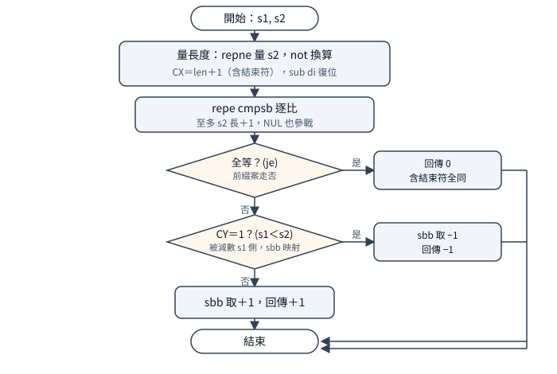

# `strcmp` 家族：三值比較與大小寫折疊

一句話：Visual C++ 1.0 的四個比較函式都回 `-1／0／+1`
（`sbb` 把進位掐成三值，不是位元組差）；
`strcmp` 先量長再 `repe cmpsb`，有界的兩支取
`min(長度+1, count)`、比完重比末 byte 定勝負，
不分大小寫的兩支快路先比、失配才用無分支算術轉小寫。
延伸閱讀：同批出貨的複製家族見
[`strcpy` 家族](strcpy-family.md)；
五個記憶體模型各編出一份 `.LIB` 的來龍去脈見
[VC++ 1.0 的函式庫怎麼切份](library-combination.md)。

## 結論

四個函式分成兩種寫法、兩種作者手筆。
`strcmp` 与 `stricmp` 是整串比：前者先把第二串長度量出來、
`repe cmpsb` 至多比那麼多，含結束符全等就回 0，
否則 `sbb` 兩條把進位映射成 `-1／+1`；
後者在每個位元組上先大小寫敏感比一次（快路），
失配才把兩邊都轉小寫再比一次。
`strncmp` 与 `strnicmp` 是有界的：
先算 `count` 与「第一串長度加一」的較小值、
`repe` 比完後重比最後一個位元組定勝負
（中間的清零指令毀了旗標，只好重比），
`count=0` 直接回 0。
手筆上，`strncmp／strnicmp` 与 `memicmp`
同一個人寫的（小寫參數名、`first／last`、
`push ds／pop es`、`loop`）；`strcmp／stricmp`
另一個人（大寫、`sbb` 映射、`BX` 替 `DI`）——
同一目錄兩種風格並存，出貨就是這樣。

註解有兩處筆誤（碼都對）：`strcmp` 的 `sbb`
對照表欄位寫反（`memcmp` 的同式表格是對的，
這裡抄反了）；`stricmp` 的兩處轉小寫註解標錯邊
（第一處的 `AL` 是 `src` 側、第二處是 `dst` 側，
与檔頭演算法、`sbb` 表、行為三者皆矛盾）。
`stricmp` 的 `sbb` 表本身是對的。

## 根本問題

字串比較要回答「誰先誰後」，有四個現實約束。
第一，回傳值是三值不是差值：呼叫端只判符號，
所以尾端用 `sbb` 把進位掐成 `-1／0／+1`，
比「相減回差」省下符號規格化的麻煩。
第二，前綴案（`ab` 对 `abc`）：短邊的結束符必须參戰，
`NUL（0）对 c` 定勝負，否則前綴永遠判不準——
所以比較上界是「長度加一」（含結束符），不是長度。
第三，有界比較的語意：`count=0` 回 0（零比較即相等）、
比滿 `count` 未分勝負回 0、短串的結束符在界內照比。
第四，`repe cmpsb` 要事先給上界（`CX`）：
它只會「比到不同或數完為止」，起點給多少全靠前面的量長；
而且它跑完旗標只剩最後一組比較的殘值，
中間若有指令碰了旗標，勝負就得重比一次。

兩條指令一句話：`repe cmpsb` 是「`CX`
倒數逐位元組比、不同或數完即停」；
`sbb` 是「帶借位減」——`sbb ax,ax`
讓 `AX` 等於 `-CY`（進位是 1 得 `-1`，否則得 0），
是把旗標變成整數的最短寫法。

## 推導

### strcmp：先量再比，前綴由結束符定勝負

<p align="center"></p>

`repe cmpsb` 要上界，所以第一步是量第二串
（參數名 `dst`）的長度：`repne` 掃到結束符、
`not` 換算成「字元數加一」、`sub di,cx`
把掃過頭的指標倒回去。接著 `repe cmpsb`
至多比「第二串長加一」個位元組：全等
（含結束符對上結束符）就 `je` 回 0；
短邊先撞結束符的案子（`ab` 对 `abc`）
在 `NUL 对 c` 處停下，由 `sbb` 定勝負——
前綴短的永遠小，因為 `0` 比任何字元都小。

勝負映射是兩條 `sbb`：`sbb ax,ax` 得 `-CY`，
`sbb ax,-1` 把它變成 `-1／+1`
（`CY=1` 得 `-1`，`CY=0` 得 `+1`，
推導：第二條的借位輸入恰等於第一條的 `CY`，
故結果為 `1-2CY`）。`cmpsb` 的被減數在
`DS` 側（第一串），故 `CY=1`
當且僅當第一串小，回 `-1`——行為
`cmp-lt=-1` 与此一致。
註解的對照表欄位寫反了（把 `AX=-1`
標成 `dst<src`，實為 `src<dst` 即第一串小）：
`memcmp` 的同式表格是對的，
這裡是抄的時候沒跟著換邊。
far 版沒有飽和守衛（与 `strcpy` 不同）：
64K 无結束符的第二串會發生什麼，沒有探測，記未知。

### strncmp：有界先取小，比完重比末 byte

`strncmp` 不能照搬整串比，因為語意要求
「至多比 `count` 個」：上界是 `count`
与「第一串長度加一」的較小值。算式是
`neg／add` 兩條：`repne` 以 `count`
為界量第一串，命中 `k` 處結束符則
`CX=count-(k+1)`，取負得 `(k+1)-count`，
加回 `count` 得 `k+1`（即長度加一）；
界內沒命中則 `CX=0`，取負加回得 `count`。
`count=0` 在量長之前用 `jcxz` 擋掉，直接回 0。

`repe cmpsb` 的兩端与 `strcmp` 反過來：
`ES:DI` 放第一串、`DS:SI` 放第二串。
比完不能直接讀旗標——中間的 `xor cx,cx`
（清計數器備用）已經毀了它——所以重載
最後一個位元組再比一次
（`mov al,[si-1]／cmp al,es:[di-1]`）
定勝負：大於走 `lastbig` 回 `-1`，
等於回 0，小於走 `firstbig` 回 `+1`。
標號指的是條件（「第二串大」），不是回傳值：
第二串大即第一串小，回 `-1`，命名正確。
正負 1 用 `not` 掐出來
（`CX=0` 取反得 `-1`；先減兩次再取反得 `+1`），
与 `strcmp` 的 `sbb` 兩條是同一心思的不同寫法。

### stricmp：快路先比，失配才轉小寫

`stricmp` 逐位元組迴圈，每輪先大小寫敏感比一次：
相等（含 `NUL` 對上 `NUL`）直接下一輪，
這是快路——大部份呼叫的兩串本來就同大小寫，
快路命中就省下轉小寫的六條指令。
迴圈用 `AL=-1` 保證第一次一定進入；
結尾判斷重用 `AL`（上一輪的第一串位元組）：
`NUL` 對上時 `AL` 為零，`cbw` 展成整數 0 回傳。

失配才轉小寫，而且是無分支算術，不查表：
`sub al,'A'` 把 `A` 挪到零，
`cmp al,26` 看落不落在字母區間，
`sbb cl,cl` 把結果變成 `FFh／00h`，
`and cl,20h` 變成加量（區間內加 `20h`、
區間外加 0），`add al,cl` 加上、
`add al,'A'` 挪回來。兩邊各做一遍
（第二遍經 `xchg` 把位元組換到 `AL`
走短編碼，註解明寫動機），再比一次定勝負，
`sbb` 取 `-1／+1`、`cbw` 展成整數。
`NUL` 走這條路會回到 `NUL`
（`0-'A'=BFh`，區間外加 0，
`BFh+'A'` 進位丟棄得 0），所以轉小寫不怕結束符。

一個考據：兩處轉小寫的註解標錯邊——
第一處的 `AL` 是 `src` 側位元組卻寫 `*dst`，
第二處反之；檔頭演算法、`sbb` 對照表、
行為三者口徑一致，只有這兩行是孤兒。
（上一版私有筆記誤判 `sbb` 表寫反，
重查源碼後糾正：`sbb` 表正確，錯的是這兩行，
筆記已同步修。）
相容別名 `_strcmpi`（MS C 3.0／4.0）与
`_stricmp` 同位址（MAP 實證加行為
`cmpi-alias=0` 雙重確認）。

### strnicmp：有界加折疊，NUL 比原始值

`strnicmp` 是 `strncmp` 的骨架配上
`stricmp` 的折疊。迴圈每輪先看兩邊有無 `NUL`：
任一邊是就 `eject` 跳出——判斷在轉小寫之前，
所以結束符比的是原始值（都是 0），不經折疊。
`loop` 計數，比滿落出或 `eject` 跳出，
都到同一個出口重比末 byte
（与 `strncmp` 同理由：旗標已毀）：
等回 0，否則按進位取 `-1／+1`
（被減數是第二串側，故 `CY=1`
即第二串小、第一串大，回 `+1`）。
`count=0` 同樣 `jcxz` 擋掉回 0。

建置上有個 8.3 化石：`strnicmp.obj`
九個字元放不進 DOS 檔名，`MAKEFILE`
另寫一條截斷規則產 `strnicm.obj`；
出貨 `LIBH` 的 `COMENT A3` 寫的正是截斷名，
證明這條規則真用過（`STRCMP` 等短名檔无此問題）。
檔頭另有一行「alt entry for ANSI compatibility」
註解，但全檔唯一的程序入口就是 `_strnicmp`
本體——別名不存在，註解是從別檔贴來沒清掉的殘留，
与 `STRICMP` 真有 `_strcmpi` 對讀。

## 在執行檔裡怎麼認

四個函式的開場白分兩派，`strcmp／stricmp`
用暫存器存檔（`SI` 的舊值塞進 `BX` 或 `DX`，不動堆疊）：

```text
55 8B EC 8B D7 8B DE        ; push bp / mov bp,sp / mov dx,di / mov bx,si（strcmp）
55 8B EC 8B D6              ; push bp / mov bp,sp / mov dx,si（stricmp，dst 走 BX）
```

`strncmp／strnicmp` 用堆疊存檔，後面緊跟零數守衛：

```text
55 8B EC 57 56 ... E3       ; push bp / mov bp,sp / push di / push si / jcxz
```

（`E3` 是有界兩支的家徽：看到開場不久有 `jcxz`，
就是 `n` 家。）再往下看取參：near 資料模型用 `8B`
（`mov`，段內取參），far 模型用 `C5／C4`
（`lds／les`，連段帶位移一起取）；
取參位移在遠呼叫（medium／large）与遠資料
（compact／large）下各加 2（与複製家族同規則）。
結尾 `C3` 是 near 呼叫、`CB` 是 far 呼叫
（`pop bp` 之後那個位元組）。
各函式的獨門特徵：`strcmp` 開場不久有
`F2 AE … F7 D1 2B F9`（`repne` 量長、`not`、
`sub di` 復位）接 `F3 A6`（`repe cmpsb`
開比）；`strncmp` 有 `F7 D9 03 CB`
（`neg／add` 算 `min(len+1,count)`）；
`stricmp` 有 `B0 FF`（`AL=-1` 保證入迴圈）
接 `AC 8A 27`（`lodsb`、`mov ah,[bx]`）；
`strnicmp` 有 `B7 41 B3 5A B6 20`
（`'A'／'Z'／' '` 轉小寫常數）。
`strncmp／strnicmp` 尾端有 `8A 44 FF`
（`mov al,[si-1]`，重比末 byte 的前半）。

完整樣式（每函式四筆：S／M／C／L，
其中 `LLIBCR` 与 `LIBH` 位元組相同合併為一、
每筆開頭連續 41 bytes、出貨 `.LIB` 取出、无需遮罩）在
[`strcmp-family.json`](../../signatures/msvc-1.0-crt/strcmp-family.json)，
用法与各筆差異見同目錄的
[簽章說明](../../signatures/msvc-1.0-crt/strcmp-family.md)，
取樣前先核對該檔列出的五個函式庫 SHA-256。

## 行為規格（已證實）

測試環境：自寫測試程式，A 連 1.0 源碼重建的目的檔、
B 連 1.52 出貨庫；每案在 DOSBox 与 dosgolem 兩邊跑，
兩邊輸出逐位元組一致才算過。步數是 dosgolem
`-cpu 8086` 的計數（附帶資訊，不在表內）。
`範圍／方法` 欄標明每一列的證據等級。

| 呼叫 | 結果 | 範圍／方法 |
|---|---|---|
| `strcmp("abc","abc")` | `0` | small＋large 實測 |
| `strcmp("abc","abd")` | `-1` | small＋large 實測 |
| `strcmp("abd","abc")` | `+1` | small＋large 實測 |
| `strcmp("ab","abc")` | `-1`（前綴短的小） | small 實測 |
| `strcmp("abc","ab")` | `+1` | small 實測 |
| `strcmp("","")`／`strcmp("","a")` | `0`／`-1` | small 實測 |
| `strncmp("abc","abc",3)` | `0` | small 實測 |
| `strncmp("abc","abd",2)` | `0`（界內未分勝負） | small＋large 實測 |
| `strncmp("abc","abd",3)` | `-1` | small 實測 |
| `strncmp(s1,s2,0)` | `0`（零比較即相等） | small 實測 |
| `strncmp("ab","ab",10)` | `0`（短串界內比完） | small 實測 |
| `_stricmp("AbC","aBc")` | `0` | small＋large 實測 |
| `_stricmp("abc","aBd")` | `-1` | small＋large 實測 |
| `_stricmp("aBd","abc")` | `+1` | small 實測 |
| `_stricmp("1a","Aa")` | `-1`（非字母比原始值） | small 實測 |
| `_strcmpi("AbC","aBc")` | `0`（別名同位址） | small 實測 |
| `_strnicmp("AbC","aBc",3)` | `0` | small 實測 |
| `_strnicmp("AbC","aBd",2)` | `0`（界內未分勝負） | small＋large 實測 |
| `_strnicmp("abc","aBd",3)` | `-1` | small 實測 |
| `_strnicmp("ab","aB",10)` | `0`（NUL 在界內參戰） | small 實測 |
| `_strnicmp(s1,s2,0)` | `0` | small＋large 實測 |
| `strcmp` far、第二串 64K 无結束符 | 未執行 | 未測（无守衛，見上） |

small 廿一案（22132 步）与 large 九案（11323 步）
輸出四格全一致。回傳值恒為 `-1／0／+1`
（不是位元組差），廿一案皆然。

## 證據、方法與未知

靜態：`MASM 6.11` 的 `ML`（WinWorld 磁片組）
依原廠 `BUILD.BAT` 的旗標重編，`omfdiff` 語意比對——
DOS 五組（S／M／C／L／H）中 `strcmp／strncmp`
全數 7／7 相同（只差 `COMENT A3` 目的檔名註記），
`stricmp` 各有兩處、`strnicmp` 各有六處 `cmp`
編碼差（`38` 系对 `3A` 系：同一條比較的兩種操作數方向，
出貨組譯器与 `ML 6.11` 選擇不同），行為證等價；
Windows `wc／wl` 兩組（`wc` 快照旗標、
`wl` 去 `_WINDOWS`）各差同式編碼差、其餘全同。
A 側連結乾淨（本批顯式集无 `STRCPY／STRCAT`，
`LINKA.LOG` 零多重定義——R118 的教訓本批未犯）。

出貨与 1.52 的關係：B 側（1.52 出貨庫）四函式
与 1.0 出貨樣式逐位元組一致（簽章掃描四命中），
1.52 沿用了相同的 `cmp` 編碼選擇。
`LIBH` 的 `strnicmp` 目的檔名截斷
（`COMENT A3=fstrnicm`）与 `MAP` 的
`_stricmp／_strcmpi` 同位址（`:02D2`）
是出貨實物上的雙重確認。

未知：`strcmp` far 版 64K 无結束符第二串的行為
（无守衛，未探）；`stricmp／strnicmp` 的
far 版同類長串行為亦未探（碼面同樣无整段守衛，
靜讀，見 `strcpy` 家族的飽和分支對照）。
