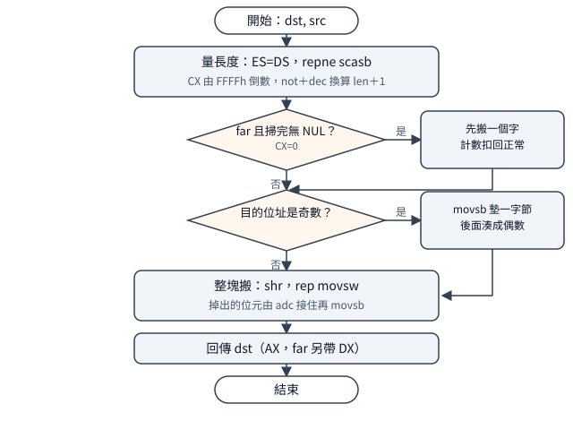

# `strcpy` 家族：複製、串接與它們的邊界

一句話：Visual C++ 1.0 的四個複製／串接函式共用「先量長度、再整塊搬」的骨架，
far 版各有一道 64K 飽和分支，而 `strncat` 藏了一個 `count=0`
時複製 65535 個位元組的真 bug。
延伸閱讀：量長度那半邊的完整解剖見
[`strlen` 的兩種長相](strlen-anatomy.md)；
五個記憶體模型各編出一份 `.LIB` 的來龍去脈見
[VC++ 1.0 的函式庫怎麼切份](library-combination.md)。

## 結論

四個函式分成兩種寫法。`strcpy` 與 `strcat` 是兩遍式：
第一遍用 `repne scasb` 把來源長度量出來，第二遍用
`rep movsw` 整塊搬，搬之前先看目的位址奇偶，
奇位址先搬一個位元組把後面湊成偶數。
`strncpy` 與 `strncat` 是有界的：前者逐位元組拷貝、
提早遇到結束符就把剩下的 `count` 補零；
後者先找到目的字串尾端，再把來源至多接上 `count` 個字元、
最後一定補一個結束符——除了 `count=0` 這個例外，
它會失控複製 65535 個位元組（下面詳述，出貨版就這樣，
1.52 版也沒修）。

far 資料模型（compact／large）下四個函式各有一道守衛，
處理「掃完 64K 還沒看到結束符」的情況：
`strcpy` 與 `strcat` 把整段搬完，`strncpy` 與 `strncat`
本來就有 `count` 上限所以不受影響。
near 模型信任呼叫端給的是正常字串，沒有這道分支。
四個函式都不保留 `BX`（拿它當暫存），`SI`／`DI` 則一定還原。

## 根本問題

1989 年的 C 字串是以 `0` 結尾的一串位元組，複製它有三個現實約束。
第一，長度事先不知道：要嘛先量再搬（兩遍），
要嘛邊搬邊看（單遍），前者搬得快、後者省一遍掃描。
第二，一個段最多 64K：`CX` 倒數掃完整段會繞回零，
far 版得決定這算長度零還是算整段，未處理的話複製函式會靜默搬錯份量。
第三，`SI`／`DI` 是被呼叫端必須保留的暫存器，
函式內部拿它們當來源／目的指標，就得先存後還；
而 `BX` 沒有這層約定，可以直接拿來用——
這家人全都這麼幹，所以呼叫完 `BX` 一定髒了。

## 推導

### strcpy：先量再搬，奇位址先墊一個位元組

<p align="center"></p>

長度未知但搬移論塊計價，所以拆兩遍是划算的：
第一遍 `ES` 暫時指向來源段、`repne scasb` 從 `FFFFh`
倒數找到結束符，`not` 加 `dec` 換算成「字元數加一」
（含結束符本身）；第二遍把 `ES:DI` 切到目的端整塊搬。
搬之前讀一次目的位址的最低位：奇位址先 `movsb` 一個位元組，
剩下的偶數字節數 `shr` 取半用 `rep movsw` 搬，
`shr` 掉出去的那個位元由 `adc` 接住再補一個 `movsb`。
8086 上字組搬移比位元組搬移快約一倍，對齊的代價只是一次測試、
至多一個位元組的零頭，這筆帳怎麼算都划算。

far 版多一道飽和分支，長在量完長度之後：
正常找到結束符就直行；`CX` 歸零（掃了 65535 個位元組還沒看到 `0`）
就先搬一個字出去、計數器扣掉對應份量，
後面當正常長度繼續——結果是整整 64K 全搬。
判斷用的是 `repne` 留下的零旗標：`repne` 與判斷之間只隔一條
`not`，而 `not` 不動旗標，所以沿用是安全的。
這是全函式庫通用的小慣用法（`strlen`、`strset` 的 far 版同式）。

### strncpy：逐位元組是為了中途停下

`strncpy` 不能照搬兩遍式，因為語意要求「來源提早結束就把
`count` 補滿零」：搬到第幾個停下事先不知道，整塊搬反而礙事。
所以它是單遍逐位元組迴圈：取一個、是結束符就跳出、
否則存下、`loop` 計數。跳出後（或 `count` 用完後）
`CX` 剩多少就補幾個零——`count` 恰好用完時剩零、
一個不補，這正是標準說的「截斷時不補結束符」。
`count=0` 在迴圈前用 `jcxz` 擋掉：零寫入、直接回傳目的位址。
逐位元組在 8086 上比 `rep movsw` 慢，但 `strncpy`
的語意本來就不是為速度設計的（定寬欄位填充），正確優先。

### strcat：找尾、量長、搬，三段串起來

`strcat` 是「`strlen(dst)`＋`strcpy` 後半」的拼裝：
先掃出目的字串的結束符位置（掃過頭的那一格要退回來），
再對來源跑一遍 `strcpy` 式的量長，最後把來源
（含結束符）搬到目的尾端。far 版的飽和處理与 `strcpy`
同結果（64K 全搬）但寫法不同：它用「搬完發現計數器是零」
認出飽和案，補搬一個字再把計數器修回來。
一個小考據：註解說對齊檢查看的是目的端，
實際程式碼看的是來源端；看哪一邊都是合法的效能取捨
（來源對齊同樣加速 `rep movsw`），行為測試兩邊都過，
所以是註解抄錯，不是程式寫錯。

### strncat：有界附加，與 count=0 的真 bug

`strncat(dst, src, count)` 先找到目的尾端，
再以 `count` 為界量來源：界內看到結束符就排除它、
算出實搬數；界內沒看到就搬滿 `count`。
搬完一定補一個結束符——這個保證是 `strncat` 与 `strncpy`
最大的不同（後者截斷時不補）。補的那個零不是現寫的，
是迴圈初就歸零的累加器一路帶下來的
（中間的掃描搬移指令都不碰它）。

bug 在 `count=0`。量來源的那次 `repne` 以 `count` 為界，
`count=0` 時零步退出、零旗標沿用「找目的尾端」那次的舊值。
目的字串正常結尾時舊值為真，程式便誤判為「界內看到結束符」，
把計數器加一再相減，實搬數算成 `FFFFh`：
**複製 65535 個位元組外加一個結束符**。
实测（large 模型，兩塊 68K 記憶體，`dst` 預填哨兵）：
`dst[0]` 与 `dst[100]` 皆被來源圖案覆寫。
1.52 的出貨版同樣中招；2.0 的 Alpha 版把這函式改寫成 C 之後才修好。
small 模型同源碼理應同犯，但 small 下跑這個測試會直接炸掉堆疊，
沒有執行（碼面推導，強推論）。

## 在執行檔裡怎麼認

四個函式的開場白分兩派，`strcpy`／`strcat` 用暫存器存檔：

```text
55 8B EC 8B D7 8B DE        ; push bp / mov bp,sp / mov dx,di / mov bx,si
```

`strncpy`／`strncat` 用堆疊存檔：

```text
55 8B EC 57 56              ; push bp / mov bp,sp / push di / push si
```

再往下看取參：near 資料模型用 `8B 76／8B 7E`
（`mov si/di,[bp+n]`），far 模型用 `C5 76／C4 7E`
（`lds si／les di`）；far 呼叫（medium／large）的位移再加 2
（返回位址佔 4 個位元組）。結尾 `C3` 是 near 呼叫、
`CB` 是 far 呼叫。各函式的獨門特徵：`strncpy` 開場不久有 `E3`
（`jcxz` 零數守衛）；`strcat` 有 `8D 75 FF`
（掃過頭退一格）；`strncat` 有 `4F`（同作用的 `dec di`）。
`strcpy` far 版在量長之後有一小段飽和頭
（`je` 分岔、`movsw` 開路），near 版沒有。

完整樣式（每函式五個模型各 27 bytes、出貨 `.LIB` 取出、
无需遮罩）在
[`signatures/msvc-1.0-crt/strcpy-family.json`](../../signatures/msvc-1.0-crt/strcpy-family.md)，
取樣前先核對該檔列出的五個函式庫 SHA-256。
`LLIBCR` 与 `LIBH` 的樣式逐位元組相同（差別只在公開符號
`_strcpy` 對 `__fstrcpy` 等），JSON 已合併。

## 行為規格（已證實，實測）

下表每一格都在 DOSBox 与 dosgolem 兩邊跑過，
A（1.0 源碼重建）B（1.52 出貨庫）逐位元組一致；
步數是 dosgolem `-cpu 8086` 的計數。

| 呼叫 | 結果 |
|---|---|
| `strcpy(d, "hello")` | `d` 變 `hello`，回傳 `d` |
| `strcpy(d, "")` | `d` 變空字串，寫入 1 byte（結束符） |
| `strcpy` far、來源 64K 无結束符 | 整段搬完（含目的端最後一格） |
| `strncpy(d, "hi", 5)` | `d` 前兩格 `hi`，後三格補零 |
| `strncpy(d, "hello", 3)` | `d` 前三格 `hel`，**不補結束符** |
| `strncpy(d, s, 0)` | `d` 完全不動，回傳 `d` |
| `strcat(d, "bar")`（`d` 初值 `foo`） | `d` 變 `foobar`，回傳 `d` |
| `strcat(d, "")` | `d` 不變（只重寫一遍結束符） |
| `strcat("", s)` | 等同 `strcpy` |
| `strncat(d, "hello", 3)` | 接上 `hel` 再補結束符，回傳 `d` |
| `strncat(d, s, 0)` | **bug**：複製 65535 byte＋結束符（見上） |
| 四函式呼叫後 | `SI`／`DI` 復原，`BX` 必髒 |

`strcat` 的 large 行為沒有實測（核心碼路与 small 同源、
靜態已覆蓋，且它沒有值得在 large 單獨探的跨段分支）；
`strncat` 的 small `count=0` 同理未執行。兩處皆在上表及正文標明。

## 證據、方法與未知

靜態：1.52 的 `ML 6.11` 依原廠 `BUILD.BAT` 的旗標重編，
`omfdiff` 語意比對——DOS 五組（S／M／C／L／H）与
Windows 兩組（`CLIBCW`、`LLIBCW` 去 `_WINDOWS`）全數 7／7
相同（只差目的檔名註記）；Windows 出貨成員与 DOS 同名件甚
至逐位元組一致。行為：自寫測試程式，A 連 1.0 重建目的檔、
B 連 1.52 出貨庫，small 十二案（27023 步）与 large 五案
（1219015 步，64K 拷貝所致）四格全一致。
`strncat` 的 `count=0` 与 `strcpy` 飽和分支是
large 下用整段記憶體實測的（`ncat-0`、`cpy-sat`），不是推的。

方法上的一個教訓：A 側連結必須對 1.0 自家函式庫。
把 1.0 重建的 `STRCPY.OBJ`／`STRCAT.OBJ` 与 1.52 的
`SLIBCE` 連在一起，`LINK` 必報多重定義
（只發生在這兩個符號身上，其餘二十二個並不會；
微觀機制未明，已排除檔名、大小寫、結構、多重匯出）。
R118 的第一版 A 側數據就栽在這上面，後來全部改對 1.0
重連重跑才轉正——讀者若自己重做對拍，直接避開這個組合。

未知：`strcat` 註解与程式碼看不同一邊的對齊，
是筆誤還是改寫殘留，無從分辨（行为兩邊都對）；
Windows 版 `STRDUP` 是全 `STRING` 目錄唯一帶 `?IA`
首尾的成員，為何獨厚它，仍是懸案（与本篇無關，記在
`?IA` 首尾調查）。
