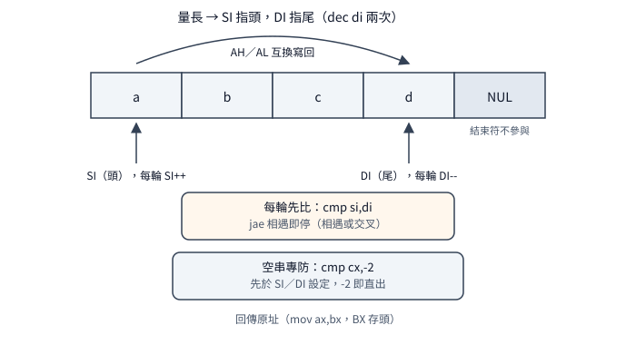

# `strlwr` 家族：就地改寫的五種手法

一句話：Visual C++ 1.0 的五個就地改寫函式裡，
`strlwr／strupr` 是鏡像手寫迴圈
（30 位元組全同除兩個常數、註解各錯一行），
`strset／strnset` 是量長加 `rep stosb`
（有界那支用單一減法取 `min` 且永不覆寫結束符），
`strrev` 是雙指針互換（空串專用守衛防指針繞行）。
延伸閱讀：搜尋家族見
[`strchr` 家族](strchr-family.md)，
比較家族見
[`strcmp` 家族](strcmp-family.md)。

## 結論

五個函式全是就地改寫：讀寫同一串、
回傳原指標、不配置任何記憶體。
`strlwr／strupr` 拿 `BX` 當游標逐字改寫，
區間檢查用無號技巧
（`sub 'A'／cmp 26／jnb`，一次排除區間兩側），
迴圈用跳入式（先測結束符、空串直出），
`cEnd`（MASM 函式尾巨集：依保存表發 `pop／ret`，
此處保存表是空的故只發 `pop bp／ret`，
等於手寫收尾）不存 `SI／DI`（主迴圈只動 `BX` 游標，
far 版另借 `CX` 存段、進出配平），
原址存 `DX`、`xchg` 交卷，`BX／DX` 照髒。
（`strset／strnset` 回傳走 `mov ax,dx`，
`strrev` 回傳走 `mov ax,bx`——
`xchg` 交卷僅 `lwr／upr` 兩支。）
兩檔是鏡像複貼：30 位元組碼面
（出貨 `.LIB` 取出的機器碼位元組）只差兩處常數
（`sub` 与 `add` 的 `'A'／'a'` 互換；
`cmp` 同為 26，組出來一字不差），
註解卻各錯一行（`strlwr` 檔頭方向寫反、
`strupr` 入口寫成 lowercase——
複貼時兩邊都沒校）。
`strset` 量長（`not` 加 `dec` 扣掉結束符）
後 `rep stosb` 全填；`strnset` 先 `BX＝count`、
`jcxz` 擋零、有界 `repne` 量長、
`inc` 扣掉結束符、`sub bx,cx` 一次得
`min(len,count)`——結束符永遠不在填寫範圍內。
`strrev` 量長後 `SI` 指頭、`DI` 指尾，
`cmp si,di／jae` 相遇即停，
`AH／AL` 互換後寫回兩端；
空串有專用守衛（`cmp cx,-2`，
`CX＝-2` 即長度零），單字元由相遇檢查擋下
（`SI＝DI` 即停，一次都不換）。

`BX` 去留：`strset` 保持
（全程只需字串起點，`DX` 存回傳值足矣，
用不到 `BX`）；其餘四支必髒
（游標、計數、頭指標各取所需）。
檔頭 `Uses: BX, CX, DX` 在 `lwr／upr`
白紙黑字——与 `strcpy／strcat／strcmp` 等多檔同式，
是這家人的集體自述，不是哪一支的首創；
探針与自述吻合。

## 根本問題

就地改寫有四個現實約束。
第一，輸入即輸出：省下配置与回傳新串的麻煩，
代價是原串被破壞（呼叫端傳字串常數進來就等著當機——
這是介面契約，不是實作能救的）。
第二，區間檢查：大小寫轉換每字元都要問
「在不在 `A–Z`」，樸素寫法兩次比較；
無號減法把它壓成一次（減 `A` 後小于 26 即在區間內，
小於 `A` 的 wraparound 成大數一併排除）。
第三，上界与結束符：填寫必須停在結束符之前
（`strset` 量長扣一，`strnset` 取 `min`），
反轉必須處理長度零与一（退化案不設防就繞行或空轉）。
第四，暫存器分工：8086 通用暫存器只有四個半，
游標、計數、回傳值各據其一，
`BX` 拿去當游標就沒有乾淨的 `BX` 可言——
`Uses` 自述（檔頭註解，不影響編譯；
「髒」指呼叫完暫存器值被改掉，
呼叫端不能再假設它是舊值）即承認。
附帶：near 指標只有段內位移（2 位元組），
far 指標連段帶位移（4 位元組）；
一個段 64K，故 `CX＝-1` 起算的掃描
一遍至多 65535（`FFFFh`）個位元組；
遠呼叫的返回位址与遠指標參數各使堆疊取參位移加 2。

三條指令一句話：`rep stosb` 是
「`CX` 倒數向 `ES:DI` 填同一個位元組」；
`xchg ax,dx` 是原地互換（`lwr／upr`
拿它交卷：回傳值暫存 `DX`，結尾一換即交；
`set／nset` 用 `mov ax,dx`，`rev` 用 `mov ax,bx`）；
`jnb` 是無號不小於跳（進位為零即跳，
區間檢查的收尾）。

## 推導

### strlwr／strupr：鏡像迴圈，註解各錯一行

迴圈是手排的：`jmp first_char` 跳入式進入
（先讀字測結束符，空串一次迴圈體都不跑——
比一般迴圈每輪省一次無條件跳躍；
`even` 把迴圈頭對齊偶位址，
8086 偶位址取指較快），
`sub al,'A'／cmp al,26／jnb` 無號區間檢查。
走三個值：區間內的 `'M'(4Dh)`→減得 `0Ch`→
小於 26 借位 1→`jnb` 不跳→命中；
下界外的 `'@'(40h)`（`'A'` 上一格）→
減得 `FFh`（借位丟棄）→不小於 26→跳過；
上界外的 `'['(5Bh)`（`'Z'` 下一格）→
減得 `1Ah`＝26→不小於（相等）→跳過——
小於下界的 wraparound 成大數、
大於上界的本來就大，一次比較全排除，
命中加 `'a'`（`upr` 版加 `'A'`）寫回 `[bx]`，
`inc bx` 前進。`BX` 游標、`DX` 存回傳原址，
結尾 `xchg ax,dx` 交卷——
`cEnd` 不存 `SI／DI`（主迴圈只動 `BX`，无須存），
`BX／DX` 照髒（檔頭 `Uses` 自述）。
兩檔碼面 30 位元組只差兩處
（`sub` 常數 `41h／61h`、`add` 常數 `61h／41h`
互換；`cmp` 同為 `1Ah`），
出貨与重建的交叉正對照（拿 `upr` 重建品
对 `lwr` 出貨品比）只報這兩處——
同源碼不同常數就該長这样。
註解是鏡像複貼各錯一行：`strlwr` 檔頭
把方向寫成「小寫轉大寫」（与標題行矛盾），
`strupr` 入口把參數寫成「map to lowercase」——
複貼時兩邊都沒校，碼都是對的。

### strset／strnset：量長一律，min 用減法一次得

`strset` 是量長加填寫：`repne` 從
`CX＝FFFFh` 倒數量長、`not` 得長度加一、
`dec` 扣掉結束符、`rep stosb` 填滿——
結束符永遠不動。走一遍 5 字元字串：
`repne` 掃 6 格（含結束符）→
`CX＝FFFFh-6＝FFF9h`→`not` 得 6
（長度加一）→`dec` 得 5→填 5 個。
far 版多一道找到才 `dec` 的分支
（`jne`：找到結束符才有長度可扣；
掃完 65535（`FFFFh`）個沒找到就填那麼多個，
与 `strcpy` 的飽和哲學同源）；
near 版信任呼叫端，无分支。
全程只需字串起點（`DX` 存回傳值足矣），
用不到 `BX`——全家族唯一的 `BX` 保持填寫函式，
探針證實（`set=1234 keep` 跨版命中）。

`strnset` 先 `BX＝count`（`BX` 當上限暫存），
`jcxz` 擋零（`count=0` 回原串，一個不填），
`repne` 以 `count` 為界量長。
結束時 `CX` 有通式（`k` 是結束符下標即長度）：
界內在 `k` 處命中→掃了 `k+1` 格→
`CX＝count-(k+1)`；界內无結束符→數完→`CX＝0`。
`inc` 扣掉結束符那格只在命中案執行
（`jne nonull` 跳過未命中案），
再 `sub bx,cx` 一次得 `min`。
代入兩案：`"hello",3`→界內无結束符→
`CX＝0`→`sub` 得 3→填三個（`YYYlo`）；
`"hello",8`→`k＝5` 命中→`CX＝8-6＝2`→
`inc` 得 3→`sub` 得 5→全填（`YYYYY`）。
`BX` 當計數器（交卷另走 `mov ax,dx`），
呼叫完必髒——是 `nset` 与 `set`
在 `BX` 去留上分流的原因：
要不要計數器，回傳型別說了不算，
算法說了算。

### strrev：雙指針相遇即停，空串專防

<p align="center"></p>

量長後 `SI` 指頭、`DI` 指尾
（`dec di` 兩次：掃過頭一格加結束符一格），
`cmp si,di／jae` 相遇即停，
`AH／AL` 分取兩端互換寫回。
偶數長（`"abcd"`，`SI＝0、DI＝3`）：
換→（1,2）→換→（2,1）→`cmp 2,1`
超越即停——偶數靠交叉停，不是相等停；
奇數長（`"abc"`）中間字元 `SI＝DI` 即停、
一次不換。`jae` 同時含相等与超越，
相遇檢查包辦兩種奇偶，不需要長度除二。
空串是退化案：`repne` 從 `CX＝-1` 起算，
每掃一格減一，掃完 `CX＝-1-(len+1)`
（本檔无 `not`，与 `strset` 不同）——
長 0／1／2 对 `CX＝-2／-3／-4`
（`FFFEh／FFFDh／FFFCh`）。
空串（`len＝0`）時 `DI` 停在 `NUL` 下一格即起點加一，
退兩次得起點減一：起點位移為 0 時繞到段尾
（`FFFFh`），相遇檢查抓不住而空轉 `FFFFh` 次
（源碼 NOTE 明寫此案）；位移 1 以上 `jae`
本就能擋，但守衛不分青紅皂白——
先 `cmp cx,-2`，是 `-2` 直出。
量長結束瞬間 `DI` 位置（空串，起點 `S`）：

```text
位址:  S      S+1
內容: [NUL]
DI  →        ★（停在 NUL 下一格）
退兩次 → S-1（S＝0 時繞到 FFFFh ╳，守衛擋下）
```
far 版多一段无結束符分支
（`je` 找到走正常路，否則 `dec di`
直入迴圈）：意圖是整段反轉，
但無號相遇檢查使其只在起點位移 0／1 時成立
（32767 次交換），位移 2 以上直接 `done`、
零交換——行為未探，以上為靜讀模擬。
`DI` 先存 `BX`（`mov bx,di`，`SI` 另從 `DI` 載入），
回傳 `mov ax,bx`（与 `lwr／upr` 的 `DX＋xchg`
不同路），`BX` 照髒——探針与碼面一致。

## 在執行檔裡怎麼認

開場分三派。`strlwr／strupr` 无存檔直入
（`BX` 游標、`DX` 回傳，`cEnd` 手寫收尾）：

```text
55 8B EC 8B 5E 04 8B D3        ; push bp / mov bp,sp / mov bx,[bp+4] / mov dx,bx
```

後面緊跟 `EB 0B`（跳入迴圈）接
`2C 41／61 3C 1A 73 04`（無號區間檢查；
`lwr` 版 `sub` 常數 `41h`、`upr` 版 `61h`，
兩支 30 位元組全同除此兩處）。
`strset／strnset` 手寫 `push di`：

```text
55 8B EC 57                    ; push bp / mov bp,sp / push di
```

`strset` 接量長（`F2 AE F7 D1 49`：
`repne`、`not`、`dec` 扣結束符）
再 `F3 AA`（`rep stosb` 全填）；
`strnset` 開場多 `E3`（`jcxz` 零數守衛）
与 `2B D9`（`sub bx,cx` 取 `min`）。
`strrev` 多存 `SI`：

```text
55 8B EC 57 56                 ; push bp / mov bp,sp / push di / push si
```

接量長（`B9 FF FF F2 AE`），後跟
`83 F9 FE`（`cmp cx,-2` 空串守衛，
中間隔空串分流的 `74 12 4F 4F`）
与 `3B F7`（`cmp si,di` 相遇檢查）。
取參位移与結尾和其他家族同規則
（遠呼叫／遠資料各加 2，`C3` 是 near 返回、
`CB` 是 far 返回；`lwr／upr` 的字串指標放 `BX`，
故取參是 `8B 5E`（near，`mov`）／
`C5 5E`（far，`lds` 連段取），
不是它支的 `7E`（`DI`）。）

完整樣式（五函式 20 筆：`LLIBCR` 与 `LIBH`
合併、每筆開頭連續 30 bytes、出貨 `.LIB`
取出、无需遮罩）在
[`strlwr-family.json`](../../signatures/msvc-1.0-crt/strlwr-family.json)，
用法与各筆差異見同目錄的
[簽章說明](../../signatures/msvc-1.0-crt/strlwr-family.md)，
取樣前先核對該檔列出的五個函式庫 SHA-256。

## 行為規格（已證實）

測試環境：自寫測試程式，測試矩陣是
2 種庫（A 連 1.0 源碼重建的目的檔、
B 連 1.52 出貨庫）× 2 種模擬器
（DOSBox、dosgolem）＝四格，
輸出逐位元組一致才算過；
small／large 是兩種記憶體模型各跑一遍，
本批 large 輸入与 small 字面全同。
`ret=1` 表示回傳指標与傳入字串頭相同
（就地改寫的簽名）。

| 呼叫（small 字面） | 結果 | 範圍／方法 |
|---|---|---|
| `_strlwr("aBcD12!Zz@")` | `abcd12!zz@`（非字母不動） | small＋large（同字面） |
| `_strlwr` 回傳 | 原址（`ret=1`） | small＋large（同字面） |
| `_strlwr("")` | 空串（零寫入） | small 實測 |
| `_strupr("aBcD12!Zz@")` | `ABCD12!ZZ@` | small＋large（同字面） |
| `_strupr("")` | 空串 | small 實測 |
| `_strset("hello",'X')` | `XXXXX`（結束符不動） | small＋large（同字面） |
| `_strset("",'X')` | 空串 | small 實測 |
| `_strnset("hello",'Y',3)` | `YYYlo` | small＋large（同字面） |
| `_strnset("hello",'Y',0)` | `hello`（一個不填） | small 實測 |
| `_strnset("hello",'Y',8)` | `YYYYY`（全填） | small＋large（同字面） |
| `_strrev("abcd")` | `dcba`（偶數換兩次） | small＋large（同字面） |
| `_strrev("abc")` | `cba`（中間不換） | small＋large（同字面） |
| `_strrev("a")` | `a` | small 實測 |
| `_strrev("")` | 空串（守衛直出） | small＋large（同字面） |
| `_strlwr／_strupr／_strnset／_strrev` 呼叫後 | `BX` 必髒 | 靜讀＋探針（R121 有效集） |
| `_strset` 呼叫後 | `BX` 保持 | 靜讀（零 `BX` 指令）＋探針 |

small 十八案（17457 步）与 large 九案（10168 步），
large 輸入与 small 字面全同，四格輸出全一致。
`BX` 保持集以 R121 重測為準
（`BXA10≡BXB`，30918 步同；本批 `set` 在保持集內）。

## 證據、方法與未知

兩種驗證各證明不同的事（靜態比重建与出貨的語意、
行為比兩種庫跑兩種模擬器的輸出，見前篇導讀）。
靜態：`MASM 6.11` 的 `ML` 依原廠旗標重編——
五組（S／M／C／L／LIBH：四個記憶體模型庫加
模型無關的 `LIBH`）中五檔全數 7／7
相同（七項語意檢查全過，
只差 `COMENT A3` 目的檔名註記）；
Windows `wc／wl` 兩組
（`wc` 用原廠建置旗標快照、
`wl` 去 `_WINDOWS`）同样全同，
且出貨成員与 DOS C／L 版逐位元組一致。
附帶正對照：拿 `strupr` 重建品对 `strlwr`
出貨品比只差兩處常數位元組——
同源碼不同常數的檔案就該長这样，
側證比對工具有在做事。
A 側連結乾淨（本批顯式集无 `STRCPY／STRCAT`，
本批五支与 1.52 `SLIBCE` 共存无多重定義：
T3／`SCSTTA` 證；其餘 22 名同）。

未知：`strset／strrev` far 版 65535（`FFFFh`）位元組
无結束符長串的行為
（碼面有分支：填 `FFFFh` 个／僅起點位移 0／1 反轉，
行為一概未探）；
`strlwr／strupr／strnset` far 版同場景
（碼面无特判，未探）。
