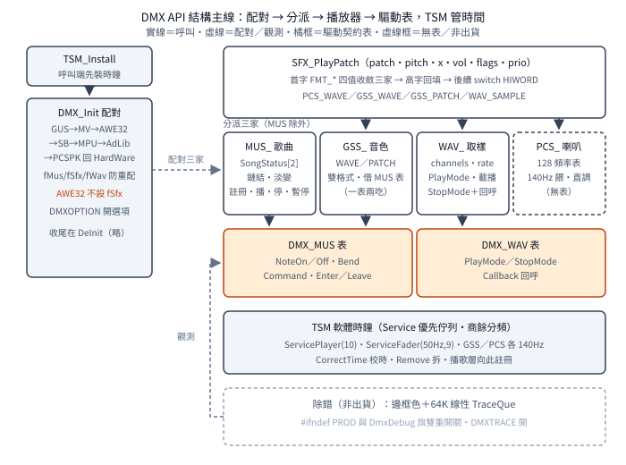

# DMX 的 API 核心：四播放器、兩張表與一個軟體時鐘

一句話：DMX 3.4a 的 `DMX_Init` 按固定順序探測七種音效硬體
（後配不覆先配），配出四個播放器
（歌曲、GSS 音色、取樣、PC 喇叭）與兩張函式指標表；
音效 handle 的高字回填格式，後續操作全按此路由；
歌曲層有雙槽加鏈結加淡入淡出，
內嵌 MIDI→MUS 轉換器，
排程靠自寫 TSM 軟體定時多工器。

## 結論

初始化是「讀環境、逐裝置配對、回硬體旗」三步：
`DMXOPTION` 環境字串開 `-opl3／-phase` 選項，
按 `AHW_*` 裝置旗逐一調各驅動 `Init()`，
`MUS_Init／GSS_Init／WAV_Init` 把命中的驅動表配給播放器
（`fMus／fSfx／fWav` 三旗防重配），
最後回 `HardWare` 位元組。
探測順序固定：GUS→MediaVision→AWE32→
SoundBlaster→MPU-401→AdLib→PC 喇叭——
先命中的卡住位置，後面同類不覆蓋。

四播放器分兩種抽象。
`MUS_` 管歌曲（吃 `DMX_MUS` 表），
`GSS_` 管 GSS 音色（借同一張 `DMX_MUS` 表——
同一驅動表餵兩種上層），
`WAV_` 管取樣（吃 `DMX_WAV` 表），
`PCS_` 直調 PC 喇叭（无表）。
`SFX_PlayPatch` 看 patch 首字 `FMT_*` 分派三家，
handle 高字回填格式
（`HIWORD` 路由：後續查播、設位、停播全按此分派）。
兩張表是裝置抽象層：
`DMX_MUS`（`Init／Enter／Leave／Callback` 等歌曲動詞）
与 `DMX_WAV`（`Init／DeInit／PlayMode／Stop` 等取樣動詞），
各驅動填一張即插即用。

歌曲層是雙槽狀態機：
`SongStatus[2]`（動作旗、現播歌、鏈結歌）、
`Song[]` 註冊表（`max_songs` 上限），
`RegisterSong／UnregisterSong／PlaySong／StopSong／
PauseSong／ResumeSong／ChainSong／FadeToNextSong／
RampVolume／QrySongPlaying／MasterVolume` 全家。
鏈結（播完接下一首）与淡入淡出（`ServiceFader`
逐 tick 調主音量）都掛在 TSM 回呼上。
`Midi2Mus` 內嵌轉換器吃標準 MIDI 生 `MUS`：
塊解析、多軌按延遲併流、三種事件處理、
寫檔，全程 `setjmp／longjmp` 錯誤出口。
除錯兩件套：非出貨版以 VGA 邊框色標執行區間
（`#ifndef PROD` 加除錯旗雙門），
64K 環形追蹤佇列落檔。

TSM 是軟體定時多工器：
`Service[]` 加 `ServiceOrder[]` 優先佇列
（按優先級与頻率排序插入），
主 tick 計數、分頻商餘累加器、揮發存取鎖；
`TSM_CorrectTime` 用 RTC（`int 1Ah AH=2`）
讀回時間、轉 BCD、回寫系統時鐘
（重設 PIT 後校時）；
啟停服務都關中斷夾取改序。

## 根本問題：沒有音效 API，也沒有執行緒

1993 年的 DOS 兩樣都沒有。
遊戲要出聲，得自己認七種卡、自己餵三種資料
（歌曲、音色、取樣），還得在只有一個硬體時鐘的機器上
同時做播放、淡入淡出、鏈結。
DMX 的回答是三層：
裝置抽象（兩張表把七種卡收斂成兩種動詞）、
路由（handle 高字讓上層不用記音效走哪條路）、
排程（TSM 把「每 N tick 做一件事」
變成可註冊的服務）。
每層都只用 C 加一點組語，不依賴作業系統。

## 推導

### 初始化：讀環境、配對、回旗

`DMX_Init` 取四參：
tick 速率（歌曲量化率）、最大歌數、
音樂裝置旗、音效裝置旗。
先讀 `DMXOPTION` 環境字串：
出現 `-opl3` 開 OPL3、`-phase` 開相位選項——
選項走環境不走參數，
同一支執行檔換環境即換行為。
再按固定順序逐裝置試 `Init()`：
命中且上層還沒配（`fMus／fSfx／fWav` 任一未設）
才配對——
「後配不覆先配」是三個旗保證的，
不是順序本身保證的。
音樂与音效可配不同卡
（兩組裝置旗各自獨立），
回傳的 `HardWare` 位元組告訴呼叫端配中了誰。

### 四播放器与兩張表

播放器是上層概念，表是下層契約。
`MUS_` 播歌曲：註冊、播、停、暫停、鏈結、淡變，
全家十五六個函式，全吃 `DMX_MUS` 表。
`GSS_` 播 GSS 音色：`GSS_WAVE／GSS_PATCH` 雙格式，
全域播放狀態機逐 tick 餵同一張 `DMX_MUS` 表——
一表兩吃，驅動不用知道上層是誰。
`WAV_` 播取樣：`WAV_PlayMode` 定格式
（測試程式用 8 位元 22050Hz）、
載 patch、播，吃 `DMX_WAV` 表。
`PCS_` 播 PC 喇叭：直調，无表
（喇叭只有開關兩態，不值得抽象）。
圖為全貌：

<p align="center"></p>

### 路由：handle 高字

`SFX_PlayPatch` 取 patch、音高、聲相、音量等六參
（`panpot` 是左右平衡），
看 patch 首字 `FMT_*` 分派
（`PCS／GSS／WAV` 三家）。
回傳的 handle 高字回填格式：
後續查播、設發聲位、停播全 `switch (HIWORD(handle))`——
呼叫端只存一個整數，路由資訊藏在裡面。
這是典型的 16／32 位元過渡手法：
handle 32 位元，高 16 免費拿來當標籤。

### 歌曲層：雙槽、鏈結、淡變

同時只播兩首的概念槽：
`SongStatus[2]` 記動作旗、現播歌、鏈結歌，
`MUS_Index` 指現用槽，另一槽備用——
鏈結（播完自動接下一首）就是換槽。
`Song[]` 註冊表按 `max_songs` 上限收歌，
`RegisterSong` 收、`UnregisterSong` 退。
淡入淡出是 `ServiceFader` 服務：
掛在 TSM 上每 tick 跑，
`Enter／Leave` 夾取驅動、
偵測主音量變更、逐級調——
淡變不是驅動功能，是排程出來的。
`Midi2Mus` 藏在同一檔：
遊戲餵標準 MIDI 檔，
它先轉內部 `MUS` 格式再播——
呼叫端看不到轉換（另有獨立命令列版工具，
見前篇）。

### 排程：TSM

TSM 只做一件事：到點調函式。
`Service[]` 登記（函式、優先級、頻率），
`ServiceOrder[]` 按序排，
主 tick 到時走一遍，夠點的調。
分頻用商餘累加器（整數除法的餘數留到下輪），
改序關中斷夾取（`PUSH_DISABLE`），
存取鎖揮發宣告（編譯器不准優化掉）。
`TSM_CorrectTime` 處理時鐘漂移：
重設 PIT 後系統時鐘不准，
從 RTC 讀回時間轉 BCD寫回去——
`__386__` 與否兩套寫法
（`int386` 或內嵌組語），照編譯目標切。

### 磁碟与測試序列

`dmxdisk.c` 是 `stdio` 縮影：
`FCB` 單塊快取讀（大讀直通、小讀先填快取）——
遊戲播歌讀檔走它，不直接碰系統呼叫。
測試程式給出最小呼叫序列：

```text
DMX_Init → MUS_RegisterSong → MUS_ChainSong(h,h)
  → MUS_PlaySong → … → MUS_StopSong
  → MUS_UnregisterSong → DMX_DeInit
WAV_PlayMode → SFX_PlayPatch → …
```

`ChainSong(h,h)` 自鏈即單曲循環。

## 在執行檔裡怎麼認

本批无簽章檔（授權：不做位元組簽章）。
手認只認三樣：
一，`DMXOPTION` 環境字串与 `-opl3／-phase`
（初始化讀它的形狀少見）；
二，`HIWORD(handle)` 路由
（連續多個 `switch` 高字的函式，
`case` 常數是 `FMT_*` 三家）；
三，TSM 服務表
（優先佇列加商餘分頻加揮發鎖的組合）。
遊戲資料檔裡的 `MUS` 格式
（`MUS\x1A` 檔頭）是另一條線索，
見前篇。

## 證據、方法與未知

全為源碼層（R97 筆記），
范围是 `dmx34a/api` 六檔加兩支測試程式；
只讀原始碼，无編譯实跑。
函式名与結構名以源碼為準
（`MUS_RegisterSong／ChainSong／PlaySong` 等全名，
筆記縮寫已在本篇展開）。

未知：各驅動 `Init()` 的實際探測行為
（无硬體不驗，見 R98 裝置篇）；
TSM 在真實 tick 速率下的抖動；
`GSS` 的全稱与來歷（源碼內无說法，不猜）。
