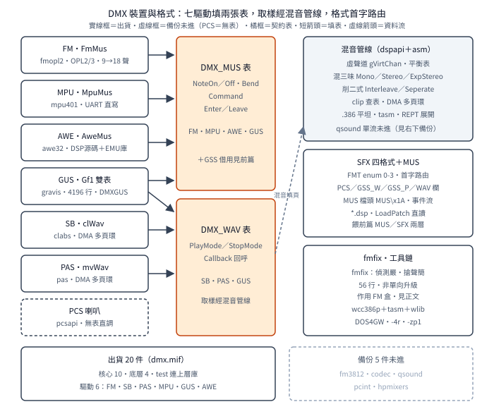

# DMX 的裝置與格式：七驅動、出貨雙軌與混音六入口

一句話：DMX 3.4a 的七種音效卡各由一支驅動檔伺候，
每支都是三件套（`Detect` 探測、`SetCard` 定址、填表），
`DMX_Init` 按固定順序逐一試命中；
封存裡另有五件未進出貨的備份（舊版與實驗分支），
以 `dmx.mif` 清單為準才不會讀錯邊；
取樣三家靠 DMA 雙頁加軟體混音，
SFX 四格式首字是順編 enum，
獨立 `midi2mus` 與庫內嵌版同源異本；
`fmfix` 偵測更嚴但搶聲更簡，不是單向升級。

## 結論

驅動三件套：每張卡＝一張表（`DMX_MUS` 或 `DMX_WAV`，
動詞見前篇）＋`*_Detect`（回 0 表命中，
並回填等待狀態與卡型）＋`*_SetCard`
（呼叫端在 `DMX_Init` 之前定埠址／IRQ／DMA，
測試程式實證 `SB_SetCard` 傳址三元）。
七家分工：`FmMus`（FM 合成，OPL2／3）、
`clWav`（Creative Labs 取樣卡）、
`mvWav`（MediaVision PAS 取樣）、
`Gf1Mus／Gf1Wav`（GUS 雙表全包）、
`MpuMus`（MPU-401）、`AweMus`（AWE32）、
PCS（PC 喇叭，無表直調，見前篇）。

出貨以 `dmx.mif` 為準，共 20 件：
核心十件（`dmxapi／musapi／wavapi／pcsapi／
gssapi／sfxapi／tsmapi／dspapi／dmxdisk／dpmiapi`）
加驅動六件（`fmopl2／clabs／pas／mpu401／
gravis／awe32`）加底層四件
（`mixers／realint／pcdma／pcints`）。
五件備份未進：`fm3812`（舊 FM，
無立體聲／平衡／搶聲計分）、
`codec`（CODEC 取樣卡，定同名 `clWav`，
與 `clabs` 只能二擇一）、
`qsound`（實驗混音，同名同入口、內核單流）、
`pcint`（舊中斷層，被 `pcints` 取代）、
`hpmixers`（第三套混音）。
讀源碼不看清單，會把備份當出貨。

FM 驅動三段式：存在測試先用 Timer-1 溢出法
（遮罩計時器、讀狀態、啟動 T1、延遲再讀，
狀態埠高三位元 0 變 `0xC0` 才算有卡），
再判 OPL3（`DMXOPTION` 的 `USE_OPL3` 位元是總開關，
沒設永遠 9 聲部；
開了再讀基底埠，讀回 0 才升 18 聲部），
運轉期靠復音分配（活躍／非活躍兩列、
175 樂器槽、音色庫）與搶聲計分
（`Rate＝Attack＋Release`，
由音色的起音衰減與延音釋放參數算出，
聲部不夠時挑分數最低且通道號不小於新音符者犧牲，
只掃活躍數減三）。
`Port 388h`、等待 6、索引延遲 6、資料延遲 24，
全是寫死的區域常數。

取樣三家共享同一套混音後端：
DMA 雙頁（`gDmaBuffer` 緩衝、每頁大小向 DSP 查詢，
播放器播一頁、混音器填另一頁）加
`dspapi` 虛聲道層（`gVirtChan[]` 記每路取樣的
位置／音量／分頻商餘、`gPanTables` 平衡表、
`PageMixed` 記已混頁）。
混音本體是六個組語入口
（`dmxClipInterleave／Seperate／Mix8bitExpStereo／
Stereo／Mono／16to8bit`，
`Seperate` 拼法原文如此）：
先混（多路 16 位元累加、可選立體聲／單聲道／
擴展立體聲）再削（`clip.inc` 查表壓回 8 位元），
`.386` 平坦模式、`tasm` 組譯。
`Interleave` 出貨版是雙流交錯
（一次處理左右兩聲道、各查表、合存），
qsound 版是單流（一次一個取樣，
仍查表、無第二聲道路徑）——
同名不同實，建置只用出貨版。

GUS 是全庫最大一支（4196 行）：
四組記憶體庫（`gf1_bank[4]`，逐庫記用量）、
聲道遮罩與年齡（分配與搶聲依據）、
音色映射（`gf1_patch` 加程式號交叉表）、
`DMXGUS.INI` 配置、32 乘 4 疊音表、
16 通道 MIDI 狀態。
MPU-401 最薄：切 UART 模式（`0x3F`）後直寫
資料佇列，連握手都省了。
AWE32 是二進位牆：`awe32.c` 只剩表骨架與呼叫端，
硬體層全在 `lib／pawe32.lib`
（無源碼的 OMF 庫，內含組譯目的碼），
探測與初始化細節在源碼層無答案——
前篇「AWE32 探測行為未知」至此結案，
不是沒讀，是沒得讀。

格式分兩群。
歌曲是 `MUS`：檔頭 `MUS\x1A` 四位元組加
音樂長度／偏移／主次通道數／音色數，
後接精簡事件流（格式定位見版本篇）。
音效是 SFX 四格式，首字 `FMT_*` 是 enum 順編
（`PCS_WAVE＝0、GSS_WAVE＝1、
GSS_PATCH＝2、WAV_SAMPLE＝3`，
正是前篇路由鍵）：
`PCS_WAVE` 首字加波長、
`GSS_WAVE` 首字加波長加 Bank／Patch、
`GSS_PATCH` 首字加 Bank／Patch／Note／
140 tick 為單位的長度、
`WAV_SAMPLE` 首字加取樣率（11025 到 44100）
加位元組長。
`WAV_LoadPatch` 讀 `*.dsp`
（測試程式實證 `drum／racecar／medium` 三檔），
`open／read／malloc` 直讀，不走 `dmxdisk` 快取。

`midi2mus` 獨立工具（1272 行）與庫內嵌版同源異本：
`TRACK／VOICE` 結構、`MAX_TRACK_SIZE 65000` 同構，
獨立版多 `PatchesUsed[189]`（追蹤用過的音色、
供 Bank 優化），內嵌版無——
改一邊另一邊不會自動跟，對讀時以各自為準。

`fmfix` 改兩處，方向相反：
偵測更嚴（基底埠讀回 0 且第二埠 `0x38A` 讀回
`0xFF` 才認 OPL3，並附四行真值表註解，
取代 3.4a 被註解自陳會在 SB Pro II 誤判的舊判式），
搶聲更簡（整套 `Rate` 計分拿掉，
改掃全部活躍聲部、挑通道號最大者，
`Channel 15→2` 特判與減三範圍一併刪除）。
3.4a 那套比較講究，所以 `fmfix` 不是單向修正版；
兩支同日、`$Log` 皆空，先後只能從目錄名與
3.4a 的註解自承推（強推論，見版本篇）。

工具鏈（makefile 實證）：`wcc386p`（Watcom C
386 保護模式）加 `tasm` 加 `wlib`，
跑在 DOS／4GW（`DOS4G＝QUIET`）上，
平坦模式、出貨 `-4r` 暫存器呼叫、
結構 `-zp1` 緊排；
`PROD／BETA／DEBUG` 三檔切編譯旗，
`test.exe` 連 `..＼lib＼dmx.lib`。
`#ifndef PROD` 除錯碼（前篇的邊框色與追蹤）
就是這套開關留下的。

## 根本問題：七種卡與三種資料，收斂點在哪

1993 年的遊戲音效是硬體叢林：
FM 合成卡吃暫存器、取樣卡吃 DMA、
MIDI 介面卡吃串列、GUS 自帶記憶體、
PC 喇叭只有開關。
DMX 的收斂分三層：
裝置層收斂成兩種動詞（播歌曲、播取樣），
混音層收斂成一條管線（虛聲道混成 16 位元、
削波成 8 位元、DMA 送卡），
格式層收斂成首字路由（四種音效資料一個入口）。
每層的代價都寫在源碼裡：
驅動要自帶探測（沒有隨插即用），
混音要手寫組語（沒有作業系統混音器），
格式要自帶魔術字（沒有登錄檔查副檔名）。

## 推導

### 三件套與出貨雙軌

新支援一張卡要交三樣東西：
填一張表（八個或五個函式指標）、
寫一個 `Detect`（回 0 表命中，
附帶回填等待狀態與卡型）、
寫一個 `SetCard`（收埠址／IRQ／DMA，
呼叫端在 `DMX_Init` 之前調）。
測試程式的順序是鐵證：
`TSM_Install` → `SB_SetCard` → `DMX_Init`，
定址永遠走在探測前面——
因為探測要往埠寫入，
寫錯埠不但測不到，還可能 hang 住別的卡。

封存不是出貨，`dmx.mif` 才是：
20 件進庫，5 件備份。
五件備份各有來歷可推：
`fm3812` 是舊 FM（差 49 行，
少掉立體聲、平衡、搶聲計分整套），
`codec` 是另一條取樣卡路線
（定同名 `clWav`，與 `clabs` 互斥），
`qsound` 是實驗混音（來歷待查），
`pcint` 被 `pcints` 取代（差一個 `s`，
`dmx.h` 的 include 跟著改），
`hpmixers` 是第三套混音（用途待查）。
讀到同名表先查 `dmx.mif`，
這是讀 DMX 源碼的第一條紀律。

### FM：存在測試、開關、搶聲

FM 驅動是三段式層層加碼。
存在測試不用讀 ID（OPL 沒有可讀 ID），
用 Timer-1 溢出法：
遮罩兩個計時器、清中斷、讀狀態（`s1`）、
設 T1 鎖存 `0xFF`、啟動 T1、
空轉延遲（80 微秒以上等溢出）、再讀狀態（`s2`）——
高三位元從 0 變 `0xC0` 才算有卡。
判式裡的 `0xE0` 遮罩與 `0xC0` 期望值寫死在碼裡，
錯一邊都不認。

OPL3 判定分兩閘：
`USE_OPL3` 位元是總開關（環境字串來，
沒設永遠 9 聲部），
開了再讀基底埠（讀回 0 才升 18 聲部、
型別記 3）。
3.4a 的第二閘太鬆，
註解自陳在某些 SB Pro II 上誤判
（原話帶髒字，此處不引）——
`fmfix` 的存在理由就是這一閘。

運轉期是復音分配加搶聲：
活躍／非活躍兩列記聲部歸屬、
`InstNotes[175]` 記每樂器現用音、
音色庫供載入。
聲部不夠時算分搶：
`Rate` 是起音速率加釋放速率
（各由音色參數的高／低半位元組反算，
15 減之——包絡越慢分越高），
掃活躍列（留三個不掃，原因待查）、
限定通道號不小於新音符、
挑分數最低者犧牲。
立體聲是後加的：
`Stereo[]` 初始全 `0x30`（中央）、
平衡三段（48 以下左、96 以上右、中間中），
舊版整套沒有。

圖為結構主線
（AWE32 二進位牆與五件備份略，見正文）：

### 取樣：DMA 雙頁與虛聲道

取樣卡不能像 FM 那樣一個音符一個命令，
得連續餵波形。
做法是 DMA 雙頁：
一塊緩衝切兩頁，卡播一頁、CPU 填另一頁，
頁大小向 DSP 查詢（`dspGetPageSize`），
`PageMixed` 記混到哪一頁——
填不贏就破音，所以混音寫成組語。
每路取樣是
一個虛聲道（`gVirtChan[]`）：
記波形位置、音量指標、
分頻商餘（取樣率轉換的商餘累加，
與 TSM 同式）、
相位與 QSound 參數。
平衡另查 `gPanTables`。
三家取樣驅動（`clabs／pas／gravis` 的 WAV 半）
共享這套後端，
差別只在怎麼把混好的頁送上各自的卡。

### 混音六入口

六個入口分兩步：混、削。
混有三味：
`Mono`（多路累加成單聲道）、
`Stereo`（左右分開累加）、
`ExpStereo`（擴展立體聲）；
`16to8bit` 是位元轉換。
削有兩式：
`Interleave`（左右交錯存成雙聲道流）、
`Seperate`（分開存，拼法原文如此）。
削波不用 `if` 夾取，
用 `clip.inc` 查表（16 位元值當索引、
一查即得 8 位元飽和值，
128 行全表，建置相依明寫在 makefile 裡）——
查表比分支快，且快多少是確定的，
混音迴圈最怕不確定的分支。
qsound 版同名同入口，
`Interleave` 改單流（一次一個取樣），
其餘待讀（範圍外）。

### GUS、MPU、AWE：大、中、小

GUS 驅動是全庫最大（4196 行，
第二名 `musapi` 才 2169 行），
因為 GUS 把事做全了：
卡上記憶體當四庫管（逐庫記基址與用量，
載音色逐庫找洞）、
聲道分配用遮罩加年齡
（`voice_mask` 記誰空、`voice_age` 記誰老，
搶聲搶最老的）、
音色映射三層（`gf1_patch` 加程式號加交叉表，
MIDI 號到卡上音色兩次翻譯）、
疊音 32 乘 4（一個音符可疊四層）、
配置外置 `DMXGUS.INI`
（卡上記憶體多大決定載哪些樣本，
見版本篇的樣本分級表）。
一家填兩張表（`Gf1Mus` 加 `Gf1Wav`），
歌曲取樣通吃。

MPU-401 最薄：
切 UART 直寫模式（命令 `0x3F`）、
之後每個 MIDI 位元組直寫資料佇列
（`MpuWriteUART`，等到不忙就寫），
其餘多是排隊與逾時處理。
AWE32 反過來最不透明：
`awe32.c` 466 行只剩表骨架、
旗標與 `EnterBusy` 臨界區，
`awe32Detect／awe32InitHardware` 全是 extern，
實作在 `lib／pawe32.lib`（Visual C 格式 OMF 庫，
無源碼）——
探測寫了什麼暫存器、初始化順序是什麼，
源碼層永遠無答案。
三家對比是 craft 展品：
同樣的表，背後可以是四千行、七百行、
或一行都沒有。

### 格式：MUS 檔頭與 SFX 四首字

`MUS` 檔頭是 `DMX_HEADER`：
`MUS\x1A` 四位元組簽名（`Eof` 即 `0x1A`，
DOS 文字檔結尾符，借來當魔術字尾）、
音樂長度、音樂偏移、
主／次通道數、音色數、保留字。
事件流接在偏移之後（見版本篇定位）。

SFX 四格式的設計是一句話：
首字 enum 路由，後面各表各的。
`PCS_WAVE` 最短（首字加波長，
波形是喇叭開關序列）；
`GSS_WAVE` 加 Bank／Patch
（波形配音色號）；
`GSS_PATCH` 無波形（Bank／Patch／Note／
140 tick 長度，純指令）；
`WAV_SAMPLE` 加取樣率與位元組長
（11025 到 44100，後接原始波形）。
`*.dsp` 檔就是裝 `WAV_SAMPLE` 的容器，
`WAV_LoadPatch` 以 `open／read／malloc` 直讀，
播歌註冊一樣吃記憶體指標——
`dmxdisk` 快取只有 GUS 驅動在用。

### 轉換器同源異本

`midi2mus／midi2mus.c`（1272 行，獨立命令列工具）
與 `musapi.c` 的 `Midi2Mus`（庫內嵌）同源：
`TRACK／VOICE` 結構同構、
`MAX_TRACK_SIZE 65000` 同值、
塊解析與三處理（事件／Meta／SysEx）同流程。
異本在 `PatchesUsed[189]`：
獨立版追蹤用過的 189 個音色槽
（供 Bank 優化），內嵌版整段沒有——
內嵌版只求轉出來能播，
獨立版還管轉得好不好。
兩邊並存、改一邊另一邊不會跟，
對讀時先認清手上是哪一本。

### fmfix：雙向差

`fmfix` 只有一支 `fmopl2.c`（加一支 `test.exe`），
與 3.4a 差 56 行（diff 行數）。
偵測改嚴：
舊判式（開關開且基底埠讀回 0）之外，
加第二埠 `0x38A` 讀回 `0xFF`，
並附四行真值表註解
（`0x388＝0x06` 是 OPL2、
`0x388＝0x00` 且 `0x38A＝0xAA` 是 OPL2、
`0x388＝0x00` 且 `0x38A＝0xFF` 才是 OPL3）。
搶聲改簡：
`Rate` 計分、`AttackRate／ReleaseRate` 欄位、
`Channel 15→2` 特判、減三範圍一併拿掉，
改掃全部活躍聲部、挑通道號最大者犧牲。
一嚴一簡，淨效果是偵測修好、搶聲退步——
所以 `fmfix` 不能直接蓋掉 3.4a，
要拿偵測修正得連搶聲一起退回去
（或自行把嚴偵測移植到 3.4a 版上，
兩處差異正交，可以只搬一處）。

### 工具鏈：Watcom 平坦三件套

makefile 是 Watcom 式（`!ifeq`、`%watcom`、
`.symbolic` 全是 Watcom 記號）：
編譯 `wcc386p`（386 保護模式 C）、
組譯 `tasm`、建庫 `wlib`，
跑在 DOS／4GW 上（`DOS4G＝QUIET` 關 banner）。
出貨旗 `-oxt -4r`（極致優化加暫存器呼叫）、
結構 `-zp1`（一位元組緊排，
格式 struct 的欄位偏移全賴它）、
除錯／測試／出貨三檔（`DEBUG／BETA／PROD`）。
`mixers.obj` 顯式相依 `clip.inc`
（改表重組，依賴寫死）；
`test.exe` 連的是上層 `..＼lib＼dmx.lib`
（編出的庫先裝到上層再連測試，
不是就地連）。

## 在執行檔裡怎麼認

本批無簽章檔（授權：不做位元組簽章）。
手認認五樣：
一，`MUS\x1A` 檔頭（遊戲資料檔裡找）；
二，`switch` 首字 `0／1／2／3` 的函式
（`FMT_*` enum 路由，`case` 四值連號）；
三，`clip` 查表削波
（`mov al,clip[eax]` 形的 16 位轉 8 位迴圈，
配 `REPT` 展開）；
四，`DMXGUS` 字串（GUS 驅動獨有，
`.INI` 配置名）；
五，`USE_OPL3` 開關讀取
（`DMXOPTION` 環境字串加 `-opl3`，
初始化段）。

## 證據、方法與未知

全為源碼層（R98 筆記加本篇核實），
範圍是 `dmx34a/api` 驅動檔、
`mixers／qsound／pztimer／realint`、
`midi2mus／midi2mus.c`、
`fmfix／api／fmopl2.c`、
`dmxsfx.h／dmxmus.h／dmxwav.h`、
`makefile／dmx.mif`、
兩支測試程式；
只讀原始碼，無編譯實跑。
出貨／備份以 `dmx.mif` 為準。
此處「已證實」指源碼白紙黑字，
非編譯對拍（授權只允許源碼閱讀）。

未知：AWE32 硬體層實作（二進位牆，
永久無答案）；
`qsound` 與 `hpmixers` 的來歷與用途
（未進出貨，待查）；
`fmfix` 與 3.4a 的先後（強推論，
`$Log` 皆空）；
搶聲減三範圍的理由（源碼無註解）；
`codec` 路線為何被棄（源碼無說法）。
