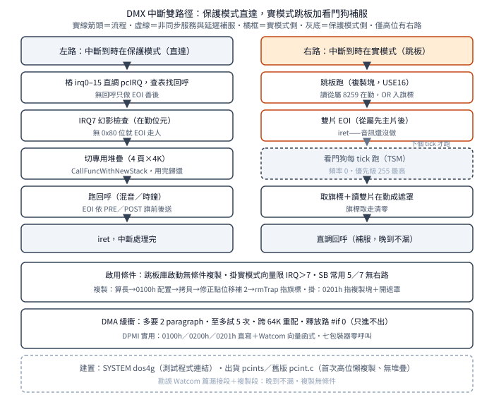

# DMX 怎麼跟 DOS extender 相處：DPMI、跳板與看門狗

一句話：DMX 3.4a 跑在 DOS/4GW 上，
對 extender 只說 DPMI（`int 31h`）；
出貨的中斷層 `pcints` 在庫啟動時
把一段 16 位元跳板複製到 1MB 以下，
高位 IRQ 才掛實模式向量，
實模式期間來的中斷由看門狗每 tick 補服——
晚到，不到；
`dpmiapi` 六個包裝器半數零呼叫、
DMA 緩衝只進不出，
都是讀出貨版才會發現的落差；
本篇另勘誤 Watcom 篇兩處舊斷言。

## 結論

實際用到的 DPMI 服務只有三組：
`0100h` 配 1MB 以下記憶體
（跳板複製與 DMA 緩衝各調一次，
都是直寫 `int386(0x31,…)`，
不是調包裝器）、
`0200h／0201h` 存取實模式向量
（只在 IRQ 8–15 安裝時）、
保護模式向量經 Watcom 執行期
`_dos_getvect／_dos_setvect` 轉調
（功能號是執行期內部事，不斷言）。
`dpmiapi.c` 六個包裝器全樹零呼叫——
有檔、有進庫、沒人調；
「鎖記憶體防缺頁」「查記憶體定緩衝」
在出貨行為裡不存在，
混音緩衝就是固定 4K。

跳板生平四步，全在 `pcInitIRQLib`：
算長度（`rmEnd−rmInt`）、
`0100h` 配置低位記憶體、
複製過去、
改寫修正點（位移補 2，
即旗標在塊內偏移；
`rmTrap` 指向塊內＋2）。
複製無條件（庫啟動即做），
掛向量才限高位：
`irq > 7` 才存取實模式向量、
才設 `0201h` 指向複製塊、
才開第二顆 8259 遮罩與級聯位；
`irq ≤ 7` 只掛保護模式那份。
SB 常用的 5／7 落在後者，
跳板對多數設定備而不用。
（舊版 `pcint.c` 未進庫：
它是首次高位 IRQ 才懶複製，
也沒有專用堆疊。）

那段 16 位元碼（`realint.asm` 全文 56 行、
`USE16` 段、三符號）只做兩件事：
把從屬 8259 的在勤位元 OR 進旗標位元組、
對兩顆晶片送 EOI（從屬先、
主片後）、`iret`。
不做音訊處理。
旗標就是兩側的交換器：
實模式側 OR 入、
保護模式側看門狗取走清零——
R99 未知項至此結案。

看門狗（`PC_WatchDog`）是 TSM 服務，
頻率 0（即每 tick）加優先級 255（最高），
首次高位 IRQ 安裝時登記：
每輪先取旗標（有值表實模式側來過中斷）、
再讀兩顆 8259 在勤暫存器合成 16 位遮罩，
對遮罩上有名且已安裝的 IRQ 直調回呼。
所以實模式期間的中斷只是晚到——
公開 Watcom 篇〈DPMI 與 DOS/4GW〉
「漏掉音訊更新」段是錯的，
勘誤見該篇補註與本篇推導。

保護模式命中走直達路：
16 樁（`irq0–15` 直調 `pcIRQ`）加
`irqHandler[16]` 表查回呼，
IRQ7 先過幻影檢查
（讀在勤位元 0x80，
沒有就 EOI 走人——
雜訊觸發的假中斷），
回呼在專用堆疊上跑
（4 頁乘 4K，
`CallFuncWithNewStack` 切換，
用完歸還），
EOI 分 `PRE／POST` 兩旗
（TSM 時鐘用前者，
音效卡回呼用後者）。

DMA 緩衝流程（`PC_AllocDMABuffer`）：
多要 2 個 paragraph、
至多試 5 次、
命中把之前的全釋放、
跨 64K 邊界就重配
（頁暫存器傳輸中不進位，
頭尾須在同一 64K）。
但釋放路是死的：
`DosMemFree` 與 `PC_FreeDMABuffer`
本體都被 `#if 0` 關閉——
DMA 緩衝只進不出，
配了就不還。

呼叫端三家加時鐘：
TSM 時鐘掛 IRQ0（`PRE_EOI`）、
SB／PAS／GUS 掛各自 IRQ（`POST_EOI`）；
SB 探測另掃 2／3／4／5／7／10
（`clDetectIrq` 探針，
跳過軟碟 6 與計時鍵盤 0／1，
含高位 10——
探測期就會觸發看門狗登記）。
建置端：`SYSTEM dos4g`
（連結行實證），
產出的程式跑在 DOS/4GW 上；
Watcom 編譯器附 extender、
DMX 用 DPMI 對它說話，
三環扣死。

## 根本問題：保護模式接硬中斷有三難

32 位元 DOS 程式的三個麻煩：
一，處理器會切換模式
（調 DOS 服務就回實模式），
中斷隨時可能落在任一側，
兩側都要有人接；
二，中斷用誰的堆疊
（打斷時正在用的堆疊可能不夠或不對，
音效回呼不能賭這個）；
三，DMA 緩衝的位址限制
（頁暫存器不進位，
緩衝不能跨 64K，
且配置服務只從低位池給）。
再加一條政治約束：
extender 各家林立，
程式不能為每一家編一個版本——
DPMI（一套中斷介面對所有 extender）
就是這條約束的答案。
DMX 的中斷層是這四條約束的逐條作答：
跳板答模式、專用堆疊答堆疊、
重配迴圈答 DMA、`int 31h` 答中立。

## 推導

### 實用的三組與零呼叫的六件

`dpmiapi.c` 有六個包裝器，
個個直寫 `int386(0x31,…)`：
配／釋低位記憶體、
鎖／解鎖記憶體、
取／設保護模式向量、
查記憶體資訊。
全樹呼叫次數是零——
不是呼叫端難找，
是真的沒人調。
實際的三組呼叫點：
`pcints` 啟動複製與 `pcdma` 自帶的
`DosMemAlloc` 各寫一次 `0100h`，
`pcints` 高位安裝寫 `0200h／0201h`，
保護模式向量走 Watcom 執行期函式。
教訓：有檔案、有進庫，
不等於有行為；
讀 DMX 先 `grep` 呼叫端，
再決定這支檔值多少篇幅。

### 跳板生平：複製、修正、掛向量

`realint.asm` 之小，
全文 56 行（含檔頭與授權）：
`_TEXT16` 段宣告 `USE16`，
三個公開符號各管一件事——
進入點、結尾（算長度）、修正點。
本體先跳過一個旗標位元組
（它在塊內偏移 2，
正是 `rmTrap` 所指），
然後讀從屬在勤、OR 入旗標、
雙片 EOI、`iret`。
複製在庫啟動即做（無條件），
修正點位移補 2
（拷貝後重定位：
旗標在新塊內的偏移），
掛向量才看 IRQ：
高位存舊的
（`0200h` 讀實模式、`_dos_getvect` 讀保護模式）、
設新的（`0201h` 指複製塊、
`_dos_setvect` 指 32 位元樁）、
開遮罩（從屬對應位元加主片級聯位 `0xFB`）；
低位只做保護模式半套。

圖為中斷雙路徑
（左直達、右跳板加看門狗補服；
僅高位 IRQ 有右路）：

### 看門狗：晚到不到

`PC_WatchDog` 的登記藏在高位安裝裡：
第一個高位 IRQ 裝上才建服務，
之後不再建。
每 tick 跑（頻率 0 即主頻，
商數 1）、優先級最高（255）：
先取旗標（取走清零，
旗標是實模式側 OR 入的在勤位元）、
再讀雙片在勤合成遮罩、
逐位調已安裝的回呼。
注意它直調回呼，
不經 `pcIRQ`
（EOI 跳板已送、堆疊是 TSM 的，
不需要再走一次直達路）。
這就是「晚到」：
實模式期間的中斷，
最晚下一個 tick 就被補服——
音訊更新遲到一個 tick，
不是人間蒸發。

### 堆疊、EOI 與幻影

直達路進 `pcIRQ` 先查表：
無回呼就走（只做 EOI 善後）。
IRQ7 多一道幻影檢查：
讀主片在勤最高位，
沒有就 EOI 走人——
IRQ7 的雜訊假觸發是 PC 老毛病，
不查會空轉回呼。
有回呼就切專用堆疊：
4 頁共 16K，
`stack_top` 逐頁下發、
`stacks` 計數防重入用盡，
回呼跑完歸還。
EOI 時機由安裝旗決定：
`PRE` 在回呼前送（時鐘）、
`POST` 在回呼後送（音效卡）。
前後之別在於允不允許回呼期間再進中斷，
時鐘要反應快、音效要連續——
各取所需。

### DMA：邊界、重試、只進不出

`PC_AllocDMABuffer` 是教科書級的
「配置加驗證」迴圈：
多要 2 個 paragraph 留滑動空間、
至多試 5 次、
每次檢查頭尾高 16 位相同
（同 64K 才收）、
命中釋放之前幾次。
頁號與偏移各有取法：
頁是位址右移 16 取低位元組、
偏移是低 16 位
（16 位元通道再右移一位，
因傳輸單位是字）。
釋放路全死：
`DosMemFree` 本體 `#if 0`、
`PC_FreeDMABuffer` 本體 `#if 0`——
命中釋放之前的迴圈還在跑，
調的卻是空函式。
DMA 緩衝配了就不還，
是寫死的選擇，
不是疏忽
（釋放的程式碼還在，只是關掉了）。

### 呼叫端與建置

三家取樣驅動加時鐘是全部呼叫端：
TSM 時鐘 IRQ0（`PRE`）、
SB 用設定 IRQ（`POST`）、
PAS 與 GUS 同式。
SB 探測最熱鬧：
`SB_Detect` 在 2／3／4／5／7／10
全掛探針再測卡，
測完全拆——
探測期掛上 10 就會登記看門狗、
設實模式向量，
拆時還原。
建置行 `SYSTEM dos4g` 一錘定音：
編出的是 DOS/4GW 程式，
`int 31h` 的另一頭是 Rational 的 extender
（隨 Watcom 附，見 Watcom 篇）。

### 兩處勘誤

第一處：Watcom 篇說實模式期間
「漏掉音訊更新」——錯。
看門狗每 tick 補服，
遲到一 tick 而已。
（低位 IRQ 另當別論：
它沒有實模式向量，
實模式期間靠 extender 反射與否，
源碼外，仍未知。）
第二處：Watcom 篇說
「只有高位 IRQ 才複製跳板」——
對舊版 `pcint.c` 成立，
出貨版改在庫啟動無條件複製，
限高位的只剩掛向量。
兩處已在該篇加補註，
證據在本篇。

## 在執行檔裡怎麼認

本批無簽章檔（授權：不做位元組簽章）。
手認認四樣：
一，`int 31h` 前置 `AX`
（`0100h` 配低位記憶體、
`0200h／0201h` 動實模式向量；
保護模式向量走 Watcom 執行期，
認 `_dos_getvect／_dos_setvect` 呼叫）；
二，`USE16` 段混在 32 位元程式裡
（三符號：進入點、結尾、修正點，
結尾減進入點即複製長度）；
三，`rmTrap` 式旗標
（複製塊內偏移 2 的位元組，
一側 OR 入、一側取走清零，
配每 tick 的輪詢服務）；
四，建置痕跡
（`SYSTEM dos4g` 連結、
`DOS4G` 字串、
`wcc386p` 工具鏈，
見前篇）。

## 證據、方法與未知

全為源碼層（R99 筆記加本篇核實），
範圍是 `pcints.c`（出貨）、
`pcint.c`（舊版對照）、
`dpmiapi.c`（零呼叫實證）、
`pcdma.c`、`realint.asm`、
`tsmapi.c`（服務頻率語意）、
`makefile`（`SYSTEM` 行）、
`dmx.mif`（出貨 20 件）、
`clabs.c`（IRQ 探測掃號）；
只讀原始碼，無編譯實跑。
此處「已證實」指源碼白紙黑字、
不是跑過。

未知：低位 IRQ 在實模式期間的去向
（extender 反射行為，源碼外）；
DPMI 功能編號未對規格書核
（規格書未取得，以源碼註解為準）；
`_dos_getvect／_dos_setvect` 對應的
DPMI 功能號（Watcom 執行期內部，
未斷言）。
